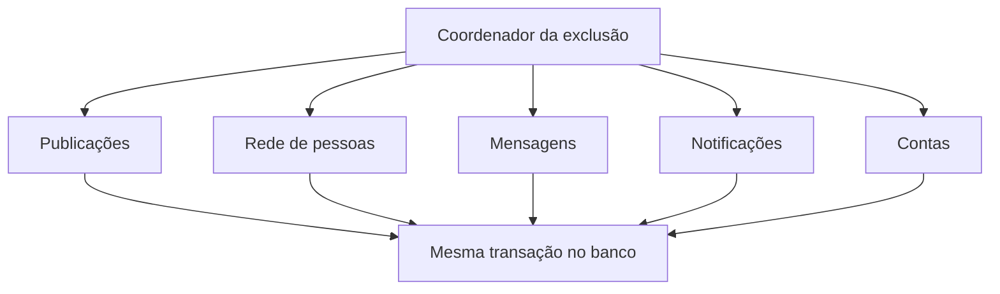

# Caso 1 aplicado: exclusão de conta

**Situação: implementado no código local e verificado.** Este registro trata do primeiro caso dos seis grupos apresentados. Os casos 2, 3, 4 e 5 também estão aplicados e possuem registros próprios; o estado do conjunto está no projeto da arquitetura. O [caso 5](caso5-operacoes-e-imagens-aplicado.md) acrescentou o registro durável das tarefas de limpeza de imagens na transação da exclusão. As evidências abaixo preservam a etapa original do caso 1.

## Parte 1 — Antes

O arquivo `src/services/account-service.ts` reunia validação de senha, consultas e exclusões de usuários, publicações, comentários, interações, seguidores, mensagens e notificações. Também acionava a limpeza das imagens do perfil.

Esse serviço precisava conhecer os detalhes de armazenamento de todas essas funcionalidades. A exclusão dos registros já usava uma transação no banco; essa garantia foi preservada.

## Parte 2 — Depois

A rota continua sendo `DELETE /api/auth/delete`. O controlador recebe o pedido e chama um coordenador da exclusão. Contas confirma usuário e senha. Cada módulo oferece sua operação de remoção e altera somente os dados sob sua responsabilidade.



O diagrama mostra as responsabilidades. No código, o coordenador aguarda cada remoção e exclui o usuário por último. A transação confirma todas as alterações ou desfaz todas se alguma etapa falhar. As imagens de avatar e capa são tratadas depois da confirmação do banco.

| Responsável | O que remove |
| --- | --- |
| Publicações | Publicações da conta, comentários feitos por ela ou recebidos em suas publicações, interações relacionadas, opções de enquetes e votos. Os votos da conta em enquetes de outras pessoas também são removidos. |
| Rede de pessoas | Relações em que a conta segue ou é seguida. |
| Mensagens | Mensagens enviadas ou recebidas pela conta. |
| Notificações | Notificações destinadas à conta ou causadas por ela. |
| Contas | O registro do usuário, após as remoções anteriores. |

Dados independentes de outras contas permanecem. Conteúdo de outras pessoas vinculado a uma publicação excluída, como comentários recebidos nela, faz parte da remoção dessa publicação.

## Onde ficou cada parte

| Caminho dentro de `sistema` | Responsabilidade |
| --- | --- |
| `src/controllers/account-controller.ts` | Recebe o pedido HTTP e mantém os códigos e mensagens esperados pela interface. |
| `src/workflows/delete-account.ts` | Coordena a exclusão por operações públicas, sem Express, Sequelize, SQL ou acesso ao disco. |
| `src/workflows/ports/unit-of-work.ts` | Define como executar uma operação completa com os módulos da transação. |
| `src/modules/accounts/public.ts` | Contratos públicos de confirmação e remoção da conta. |
| `src/modules/accounts/application/account-deletion-access.ts` | Regras de confirmação de usuário e senha, sem acesso direto ao banco. |
| `src/modules/accounts/persistence/account-deletion-repository.ts` | Consulta os dados necessários à confirmação e remove o usuário. |
| `src/modules/posts/persistence/account-content-repository.ts` | Remove conteúdo e interações sob responsabilidade de publicações. |
| `src/modules/network/persistence/account-relations-repository.ts` | Remove relações de seguir. |
| `src/modules/messages/persistence/account-messages-repository.ts` | Remove mensagens. |
| `src/modules/notifications/persistence/account-notifications-repository.ts` | Remove notificações. |
| `src/modules/*/public.ts` | Define a operação de remoção oferecida por cada módulo. |
| `src/infrastructure/database/unit-of-work.ts` | Abre a transação Sequelize e fornece repositórios ligados à mesma transação. |
| `src/infrastructure/storage/account-profile-cleanup.ts` | Usa a limpeza existente das imagens de perfil depois do commit. |
| `src/bootstrap/delete-account.ts` | Conecta o coordenador, os contratos, os repositórios, a verificação de senha e a infraestrutura. |
| `scripts/test-account-deletion-mysql.mjs` | Inicia e encerra a instância MySQL descartável para verificar a exclusão. |

O serviço antigo foi retirado. A montagem em `bootstrap` é o ponto autorizado a conhecer as implementações dos módulos. O coordenador conhece somente suas operações públicas.

Os modelos físicos permanecem em `src/models` nesta etapa. As outras funcionalidades ainda usam os serviços existentes. A separação aplicada neste caso é a do fluxo de exclusão de conta.

## Comportamento preservado e ajustes necessários

- Exigência de autenticação e confirmação da senha.
- Respostas de conta ausente, senha obrigatória, senha incorreta e sucesso.
- Uma transação para as remoções de banco.
- Limpeza do avatar e da capa após o commit, sem responder falha de exclusão por um erro posterior de disco.
- Remoção explícita dos votos e opções pelo módulo de publicações, sem depender apenas de exclusões em cascata.
- Suporte opcional a `DB_PORT`, com o padrão 3306, para permitir a instância MySQL isolada dos testes.

O processo completo de armazenamento, retenção e nova tentativa de limpeza das imagens de publicações pertence ao grupo 5. Não foi implementado neste caso.

## Verificações

Antes da alteração, a suíte existente passou com 25 casos e subcasos. Depois da alteração, a suíte comum passou com 38 casos e subcasos. O teste de MySQL fica separado e é ignorado no comando comum quando não existe uma instância descartável configurada.

```powershell
npm test
npm run test:account:mysql
```

O segundo comando localiza `mysqld` ou usa `MYSQLD_BINARY`, cria um diretório temporário e inicia um servidor exclusivo em uma porta local livre. Ele confere o diretório real do servidor antes de criar a base de teste. O teste repete essa conferência antes de criar as tabelas. A instância e o diretório temporário são encerrados e removidos depois do sucesso.

Os quatro cenários com MySQL real passaram:

| Cenário | Resultado conferido |
| --- | --- |
| Exclusão pela rota com dados nos treze modelos | Registros relacionados removidos; comparação de todos os registros independentes confirmou sua preservação; avatar e capa próprios removidos. |
| Falha forçada no módulo de notificações, após remover conteúdo, relações e mensagens | O MySQL restaurou todos os registros pela transação; imagens permaneceram. |
| Senha incorreta | Resposta 401, sem mudança em registros ou imagens. |
| Conta sem publicações ou interações | Usuário removido; dados dos demais usuários preservados. |

Os testes comuns também conferem as respostas HTTP, o uso da mesma transação pelos repositórios, a ordem de confirmação e limpeza e as fronteiras entre módulos. A checagem de dependências rejeita acesso direto a modelos no coordenador e acesso de um repositório a modelos de outro módulo.

O teste de banco cria o esquema a partir dos modelos atuais em uma instância vazia. A sequência de migrações e o esquema do banco existente não foram alterados nem validados por esse teste; pertencem ao grupo 4.

Não houve exclusão de contas reais nem envio ao GitHub nesta etapa.
