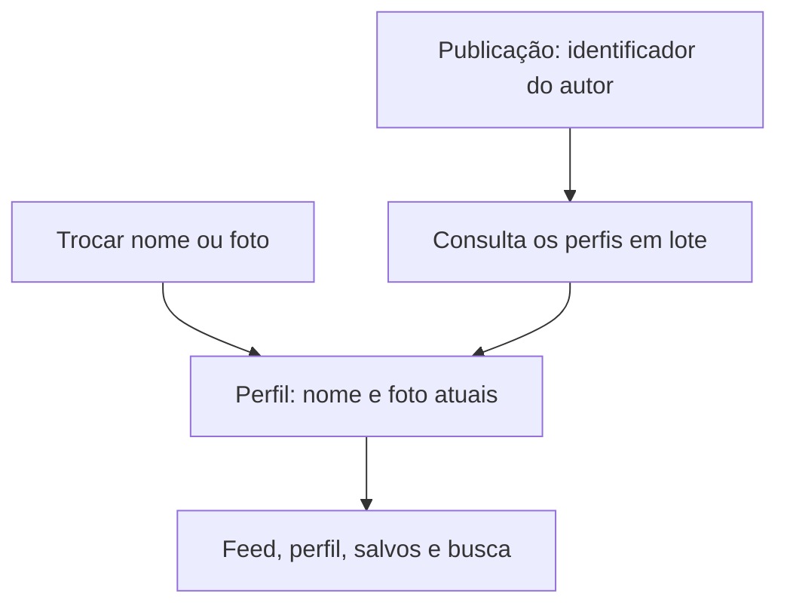

# Caso 2 aplicado: nome e foto vêm do perfil

**Situação: implementado, testado e aplicado ao banco local.** Os casos 1 a 6 estão aplicados. Os contratos comuns estão no [Caso 6: comunicação](caso6-comunicacao-aplicada.md). Este registro preserva a implementação da etapa 2; o [caso 4](caso4-banco-versionado-aplicado.md) incorporou sua atualização à sequência geral do banco. O [caso 5](caso5-operacoes-e-imagens-aplicado.md) passou as imagens novas para o armazenamento controlado e a limpeza recuperável.

## Parte 1 — Antes

A criação de uma publicação copiava o nome e a foto do usuário para `posts.author` e `posts.avatar`. Alterar o perfil exigia atualizar essas cópias em todas as publicações do autor. A inicialização do servidor também consultava usuários e publicações para tentar corrigir as cópias.

A busca de publicações pelo nome usava o nome copiado na publicação.

## Parte 2 — Depois

Nome e foto têm uma única fonte ativa: o perfil em `User`. A publicação guarda `userId`, que identifica o autor. A consulta reúne os perfis necessários em um único lote e monta a resposta para a interface.



| Antes | Mudança aplicada |
| --- | --- |
| Criar publicação gravava nome e foto nas suas colunas. | Cria a publicação com `userId` e devolve os dados atuais do autor na resposta. |
| Alterar o perfil atualizava também as publicações. | Atualiza somente o usuário; as linhas das publicações permanecem iguais. |
| Iniciar o servidor tentava corrigir nome e foto nas publicações. | Esse reparo foi retirado. O servidor verifica se a migração específica foi aplicada. |
| Buscar pelo nome usava `Post.author`. | A busca encontra os identificadores dos usuários pelo nome atual e consulta suas publicações. |
| Nome e foto apareciam em colunas da publicação. | As colunas `author` e `avatar` foram removidas de `posts`. |

Os campos `author` e `avatar` continuam na resposta da API para preservar a leitura das telas. São dados montados a partir do perfil, não colunas da publicação. Feed, perfil, salvos, busca, criação e edição usam a mesma apresentação dos dados do autor.

## Onde ficou o código

| Arquivo dentro de `sistema` | Responsabilidade |
| --- | --- |
| `src/modules/accounts/public.ts` | Contrato público `AuthorDirectory` e dados públicos do autor. |
| `src/modules/accounts/persistence/author-directory-repository.ts` | Consulta identificador, nome e foto em usuários; encontra usuários pelo nome atual. |
| `src/modules/posts/application/post-authors.ts` | Função `resolvePostAuthors`: reúne cada publicação com o perfil atual do autor, sem Express ou Sequelize. |
| `src/bootstrap/author-directory.ts` | Conecta o contrato público à implementação da consulta. |
| `src/services/post-activity-service.ts` | Monta a resposta compartilhada com os autores e as interações. |
| `src/services/posts-service.ts` | Cria a publicação sem copiar nome e foto; retorna a apresentação comum. |
| `src/services/profile-service.ts` | Salva o perfil sem consultar ou atualizar publicações. |
| `src/services/discovery-service.ts` | Busca publicações pelo nome atual do autor. |
| `src/models/Post.ts` | Modelo persistido com referência ao autor, sem `author` nem `avatar`. |
| `src/server.ts` | Inicialização sem reparo de cópias de nome e foto. |
| `src/infrastructure/database/post-author-schema.ts` | Impede abrir essa versão com as colunas antigas ainda presentes. |
| `migrations/20261120000000-use-user-profile-for-post-authors.js` | Verificação, backup, remoção das duas colunas e restauração. |
| `scripts/migrate-post-authors.mjs` | Comando explícito para conferir, aplicar ou reverter a migração. |

Uma referência de autor ausente recebe a identificação “Usuário indisponível” e foto nula, sem usar cópias antigas. A migração recusa remover colunas se encontrar publicações sem usuário válido, para exigir a conferência desses registros antes da mudança.

## Banco local e cópia de segurança

A base local tinha 22 publicações e nenhuma referência de autor inválida. A migração foi aplicada com o servidor da aplicação parado.

Antes de remover as colunas, a migração copiou seus valores e as definições das colunas para `swiftline_post_author_backup`, dentro do mesmo banco. Essa tabela é um backup para reversão: não participa de nenhuma consulta ou gravação normal das funcionalidades.

Após a aplicação, a comparação de hashes confirmou:

- As 22 publicações permaneceram com o mesmo identificador, autor por `userId`, conteúdo, imagem, contadores e datas.
- Todos os registros de usuários permaneceram iguais.
- Os índices das publicações foram preservados.
- As 22 cópias arquivadas correspondem exatamente aos valores anteriores de nome e foto.
- `posts` não possui mais `author` e `avatar`.

Uma consulta HTTP do feed local respondeu 200 com as 22 publicações. Em todas, o nome e a foto da resposta corresponderam ao perfil atual do autor.

As alterações de nome e imagem usadas para os testes ocorreram somente em uma instância descartável. Os perfis reais não foram editados nesta etapa.

## Verificações

```powershell
npm test
npm run test:authors:mysql
npm run test:account:mysql
```

A suíte comum passou com 43 casos e subcasos. As duas suítes MySQL ficam separadas e são ignoradas pelo comando comum quando não há uma instância descartável configurada.

Os seis cenários do caso 2 passaram com MySQL real:

| Cenário | Resultado |
| --- | --- |
| Criar publicação | Guarda a referência do autor e responde com o nome e a foto do perfil, mesmo se o cliente tentar enviar outros valores. |
| Alterar nome e foto | As linhas das publicações permanecem iguais; feed, perfil, salvos e busca retornam o perfil atual. O nome antigo deixa de localizar essas publicações quando não está no conteúdo. |
| Criar e editar depois da troca | As respostas continuam com os dados atuais do autor. |
| Navegador Chrome | Feed, perfil público e salvos exibiram nome e foto atuais, sem erros JavaScript. A API local de teste foi usada; provedores externos foram substituídos. |
| Migração e restauração | Backup conferido, colunas removidas, repetição sem sobrescrever backup e restauração dos valores e tipos anteriores. |
| Autor inválido | A migração recusou a remoção e preservou dados e colunas antigas. |

Os quatro cenários de exclusão de conta do caso 1 também passaram novamente no MySQL descartável após essa alteração.

## Atualização dos comandos no caso 4

O comando específico desta etapa foi substituído pelo processo único do banco. Para conferir a base sem alterar dados:

```powershell
npm run db:status
```

Em outra base existente ainda sem o novo histórico, com o servidor parado:

```powershell
npm run db:adopt
npm run db:migrate
```

A base local já está atualizada. A etapa `0004-profile-authors.js` identifica as colunas já removidas e não sobrescreve o backup anterior.

A migração original e sua operação de restauração permanecem em `migrations/history/20261120000000-use-user-profile-for-post-authors.js`. A restauração foi testada somente na base descartável. Ela exige uma volta planejada ao código e ao esquema compatíveis; não deve ocorrer sob o servidor atual em execução. Não houve reversão da base local.

Os nove arquivos anteriores foram preservados em `migrations/history`, sem reescrever seu conteúdo. Os scripts específicos da capa e dos autores foram retirados no caso 4.

Não houve envio ao GitHub.
