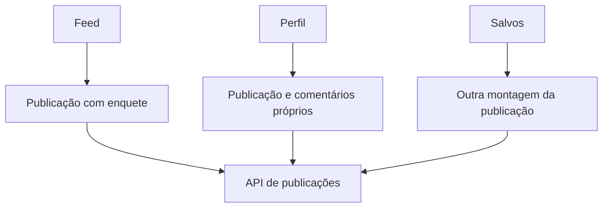
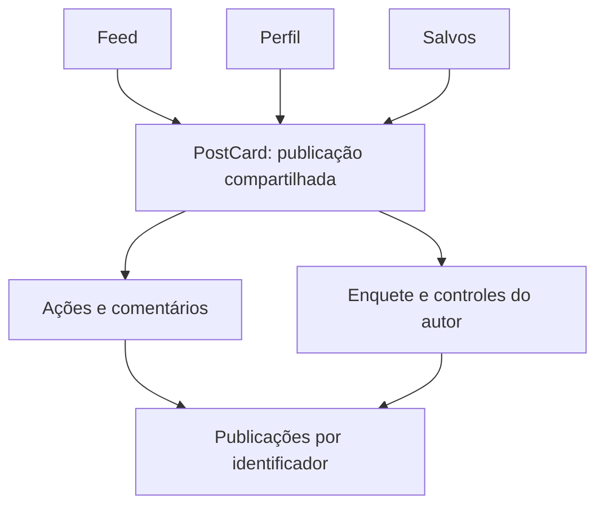

# Caso 3 aplicado: uma publicação para Feed, Perfil e Salvos

Data: 21 de novembro de 2026.

**Situação: implementado no código local e verificado.** Os casos 1 a 6 estão aplicados. Os contratos comuns estão no [Caso 6: comunicação](caso6-comunicacao-aplicada.md).

## Parte 1 - Antes

Feed, Perfil e Salvos montavam a publicação em códigos separados. O Perfil também tinha versões próprias dos botões e dos comentários. Enquetes apareciam no Feed, mas não nas outras duas telas.

Cada página mantinha sua lista de publicações. Uma correção precisava alcançar os caminhos separados para manter o mesmo comportamento.



## Parte 2 - Depois

As três páginas usam `PostCard`, da funcionalidade `client/features/posts`. Esse componente reúne autor, texto, imagem, botões, comentários, enquete e controles de edição e exclusão. Cada página escolhe a lista que deve mostrar.



| Antes | Mudança aplicada |
| --- | --- |
| Cada tela montava a publicação. | As três usam o mesmo `PostCard`. |
| O Perfil tinha outros botões e comentários. | As versões duplicadas foram retiradas; as três telas usam os componentes da mesma funcionalidade. |
| Enquetes apareciam apenas no Feed. | Perfil e Salvos também permitem votar, consultar resultados e usar as ações permitidas ao autor. |
| Cada página guardava sua cópia da publicação. | O estado comum guarda uma publicação por identificador e listas separadas para cada consulta. |
| Uma resposta de leitura podia chegar depois de uma alteração. | Uma leitura iniciada antes da alteração não substitui os dados recém-alterados. Uma publicação excluída não reaparece por uma resposta atrasada. |

Exemplo: corrigir o botão de comentário em `PostActions` passa a corrigir esse botão no Feed, no Perfil e em Salvos. Não é preciso manter três correções.

## Como as telas usam os dados

`usePostList` escolhe a consulta: feed geral, pessoas seguidas, publicações de um usuário ou salvos. `PostsProvider` mantém o resultado comum durante a sessão. Curtidas, reposts, votos, contagens, edições e exclusões alteram a publicação pelo identificador.

Remover dos salvos retira o identificador dessa lista, mas mantém a publicação no Feed e no Perfil. Excluir a publicação retira seu identificador de todas as listas carregadas. Ao trocar de conta ou sair, o estado dessa sessão é descartado.

Os pedidos de listagem são cancelados quando a consulta muda ou a página sai. O registro de visualizações usa o mesmo caminho nas três telas; o servidor preserva a contagem única por usuário e publicação.

Comentários e ações mostram falhas e permitem nova tentativa. As permissões recebidas do servidor controlam os botões de comentário; o servidor continua responsável por autorizar as operações.

## Onde ficou o código

| Arquivo dentro de `sistema` | Responsabilidade |
| --- | --- |
| `client/features/posts/index.ts` | Entrada pública usada pelas três páginas. |
| `client/features/posts/components/PostCard.tsx` | Montagem única da publicação. |
| `client/features/posts/components/PostActions.tsx` | Curtir, repostar, salvar, compartilhar e abrir comentários. |
| `client/features/posts/components/Comments.tsx` | Listar, criar, editar e excluir comentários. |
| `client/features/posts/components/PostPoll.tsx` | Votar, mostrar resultados, editar e excluir a enquete. |
| `client/features/posts/components/PostOwnerControls.tsx` | Editar ou excluir a publicação do próprio autor. |
| `client/features/posts/PostsProvider.tsx` | Estado comum por conta autenticada. |
| `client/features/posts/post-state.ts` | Atualizações por identificador e listas de cada consulta. |
| `client/features/posts/use-post-list.ts` | Carregamento, cancelamento e registro de visualizações. |
| `client/features/posts/components/PostListFeedback.tsx` | Avisos de carregamento, falha e nova tentativa. |
| `client/pages/Feed.tsx`, `SwiftProfile.tsx` e `SavedPosts.tsx` | Selecionam e exibem a lista com `PostCard`. |
| `client/App.tsx` | Abre o estado compartilhado na sessão autenticada. |

As chamadas HTTP continuam em `client/services/posts-api.ts` e `comments-api.ts`. A separação completa dos contratos da API pertence às etapas posteriores.

## Verificações

```powershell
npm test
npm run test:posts:mysql
npm run test:authors:mysql
npm run test:account:mysql
```

A suíte comum passou com 49 casos e subcasos. As três suítes MySQL são ignoradas nesse comando e executam separadamente em instâncias descartáveis.

Os seis cenários do teste de publicações usaram Chrome e MySQL real, ambos com dados de teste:

1. Ações, enquetes e permissões de comentários nas três telas.
2. Curtida, repost, compartilhamento, salvar e remover dos salvos; leitura atrasada e visualização única.
3. Criar, editar e excluir comentário a partir de cada tela.
4. Votar a partir de cada tela e conferir o resultado nas demais.
5. O autor edita e exclui publicações e enquetes nas três telas; retirar a enquete preserva a publicação.
6. Falhas controladas de interação e comentários preservam a tela e permitem nova tentativa.

Os testes unitários também verificam a atualização comum, a ordem das listas, a proteção contra respostas atrasadas e a separação entre remover dos salvos e excluir a publicação. Uma verificação das dependências confirma que as três páginas usam a entrada pública e não mantêm outra implementação do cartão.

Os testes de regressão dos casos 1 e 2 passaram novamente. As capturas do navegador e os relatórios estão em `test-results`.

## Alcance desta etapa

A mudança reorganiza a responsabilidade pela publicação na interface. O código do servidor e as migrações permaneceram iguais à cópia anterior ao caso 3, por comparação de hashes. Esta etapa não alterou o banco da aplicação.

O estado compartilhado vale para a sessão aberta nessa aplicação. Atualizações em tempo real entre navegadores não fazem parte desta etapa. A preparação do banco foi aplicada depois, no [caso 4](caso4-banco-versionado-aplicado.md), e a coordenação das operações e das imagens no [caso 5](caso5-operacoes-e-imagens-aplicado.md). O formato comum de erros foi aplicado no [Caso 6: comunicação](caso6-comunicacao-aplicada.md).
