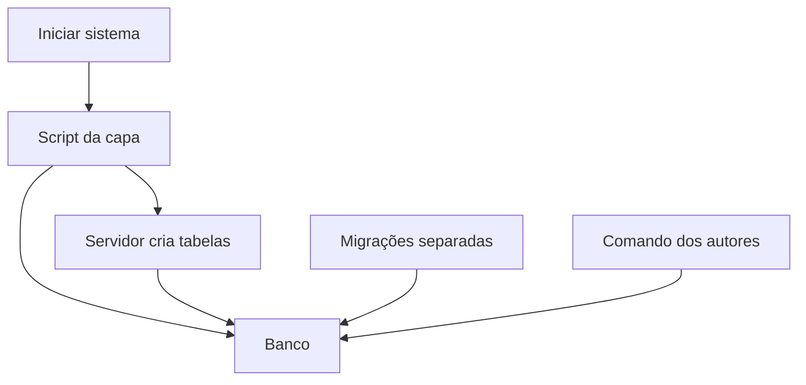
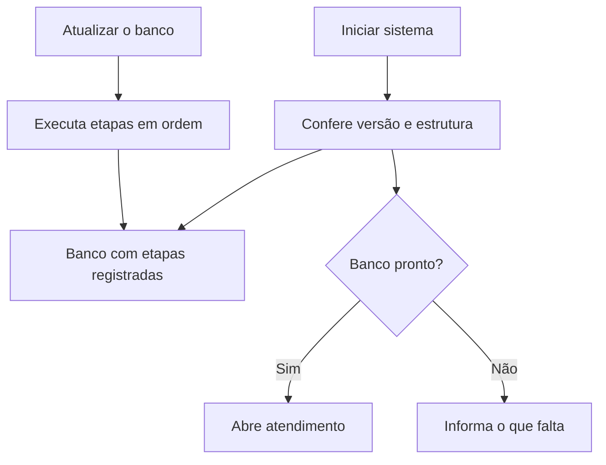

# Caso 4 aplicado: um processo para preparar o banco

Data: 21 de novembro de 2026.

**Situação: implementado, testado e aplicado à base local.** Os casos 1 a 6 estão aplicados. Os contratos comuns estão no [Caso 6: comunicação](caso6-comunicacao-aplicada.md). Este registro preserva as quatro etapas da implantação original do caso 4. O [caso 5](caso5-operacoes-e-imagens-aplicado.md) acrescentou a quinta migração, com a fila técnica de limpeza, sem alterar os arquivos das quatro anteriores.

## Parte 1 - Antes

O banco mudava por caminhos separados:

- O servidor executava `sequelize.sync()` ao iniciar e criava tabelas ausentes.
- Um script separado criava a coluna da capa antes de iniciar o sistema.
- Os arquivos de migração não formavam uma instalação completa. O caso 2 também tinha um comando próprio para retirar as cópias de nome e foto.

Não havia um registro único que comprovasse todas as etapas necessárias para esta versão do sistema.

## Parte 2 - Depois

`db:migrate` aplica uma sequência numerada. O banco registra cada etapa concluída. Ao iniciar, o servidor apenas conecta e confere a versão e a estrutura. Se faltar uma etapa, ele informa o comando necessário e não abre o atendimento.

| Antes | Mudança aplicada |
| --- | --- |
| Iniciar também podia criar tabelas. | Iniciar somente verifica o banco. |
| A capa tinha um script próprio. | A capa faz parte da sequência de migrações. |
| A retirada das cópias de autoria tinha outro comando. | Essa mudança também faz parte da sequência, com o backup já previsto no caso 2. |
| Uma instalação vazia não tinha uma sequência completa. | A sequência cria as 13 tabelas da aplicação, com suas colunas, chaves e relacionamentos. |
| Era necessário deduzir o que já tinha ocorrido. | Uma tabela técnica registra a versão, o conteúdo do arquivo e o resultado de cada etapa. |

Exemplo: criar a coluna da capa deixou de ser uma tarefa de um script acionado ao iniciar o sistema. Ela é uma etapa numerada do mesmo processo usado para instalar ou atualizar o banco.

## Comandos

Execute dentro de `sistema`, com as dependências instaladas, a configuração do MySQL definida e o servidor parado. O banco indicado por `DB_NAME` deve existir; pode estar vazio.

| Comando | Faz |
| --- | --- |
| `npm run db:status` | Consulta as etapas e a estrutura. Não altera o banco. Retorna código de saída 1 se o banco não estiver pronto. |
| `npm run db:adopt` | Confere uma base existente e registra sua versão inicial. Recusa estrutura incompatível ou referências inválidas. |
| `npm run db:migrate` | Instala uma base vazia ou aplica as próximas etapas de uma base registrada. |
| `npm start` | Compila o servidor, confere o banco e abre o sistema se ele estiver pronto. |

Uma instalação vazia usa `db:migrate`. Uma base antiga sem esse histórico usa `db:adopt` e depois `db:migrate`. A base local já passou pelos dois comandos e está pronta.

## Organização do código

| Local dentro de `sistema` | Responsabilidade |
| --- | --- |
| `migrations/current/0001-initial-schema.js` | Esquema inicial fixo das 11 tabelas principais. |
| `migrations/current/0002-profile-cover.js` | Coluna da capa, caso ainda não exista. |
| `migrations/current/0003-polls.js` | Duas tabelas das enquetes e suas chaves. |
| `migrations/current/0004-profile-authors.js` | Retirada das cópias de autoria, com backup, caso ainda existam. |
| `migrations/current/schema-contract.json` | Estrutura esperada, fixada a partir da inspeção da base. |
| `migrations/history` | Nove arquivos anteriores, preservados sem alterar o conteúdo. Não entram na sequência atual. |
| `src/infrastructure/database/migrations.ts` | Ordem, histórico, conferência dos arquivos e exclusão mútua entre atualizações. |
| `src/infrastructure/database/schema-inspection.ts` | Conferência de colunas, tipos, nulabilidade, valores padrão, chaves, relacionamentos e referências. |
| `src/infrastructure/database/db-command.ts` | Entrada dos três comandos do banco. |
| `src/config/database-options.ts` | Leitura comum da configuração do banco. |
| `src/server.ts` | Conecta e confere o banco antes de abrir o atendimento. |

Os dois scripts específicos foram retirados. Os testes MySQL dos casos anteriores também passaram a instalar suas tabelas por essa sequência, sem `sync()`.

## Dados locais preservados

A mudança foi testada primeiro em uma cópia da base. Depois, com a aplicação parada, uma nova cópia precedeu o registro na base original.

A comparação de hashes e das definições confirmou que as 15 tabelas anteriores mantiveram todas as linhas e suas estruturas. Isso inclui os 21 usuários, as 22 publicações e o backup de autoria do caso 2. A única tabela adicionada foi `swiftline_schema_migrations`, com quatro etapas concluídas.

O esquema inicial preserva as regras e as colunas históricas encontradas na base. Não deduplica contas nem impõe novas restrições sobre seus dados. Os modelos atuais foram usados na conferência de funcionamento, não como gerador automático da estrutura a cada inicialização.

## Verificações

`npm test` passou com 49 casos e subcasos. As quatro suítes MySQL executam separadamente; os testes dos casos 1, 2 e 3 passaram novamente após a troca da preparação.

`npm run test:database:mysql` verificou:

1. Consulta e inicialização de uma base vazia não criam tabelas.
2. A instalação cria as 13 tabelas e permite gravar dados pelos 13 modelos; as chaves de interações rejeitam duplicações.
3. Arquivo alterado após o registro ou versão desconhecida impede a abertura.
4. Uma interrupção após a primeira tabela fica registrada; a nova execução retoma a etapa.
5. Duas atualizações não executam as etapas ao mesmo tempo.
6. Uma mudança de estrutura fora da sequência impede a abertura e não provoca reparo automático.
7. A adoção recusa estrutura incompatível e registros com referências inválidas.
8. Uma base anterior recebe capa, enquetes e autoria atual pelo mesmo processo.
9. Uma cópia da base local mantém todos os dados e definições após adoção e atualização.

O último cenário usa uma cópia privada opcional por `SWIFTLINE_DATABASE_SNAPSHOT`; sem ela, somente esse cenário é ignorado. Ele foi executado nesta etapa. Os demais cenários usam dados criados pelo próprio teste.

## Falhas e recuperação

O MySQL pode confirmar uma alteração de estrutura antes de uma falha posterior. Por isso, cada etapa registra início, sucesso ou falha; não há promessa de desfazer todo o DDL com uma transação.

As etapas permitem repetir a execução sem recriar tabelas ou sobrescrever backups já válidos. Uma estrutura ou um backup incompatível interrompe o processo e exige conferência. Para uma atualização com dados, preserve uma cópia antes de executar; uma restauração usa essa cópia e o código correspondente. Não há comando automático que apague todas as tabelas para reverter a instalação.

As transações e as imagens foram tratadas no [caso 5](caso5-operacoes-e-imagens-aplicado.md). Os contratos gerais de comunicação foram aplicados no [Caso 6: comunicação](caso6-comunicacao-aplicada.md), com a sexta migração.
