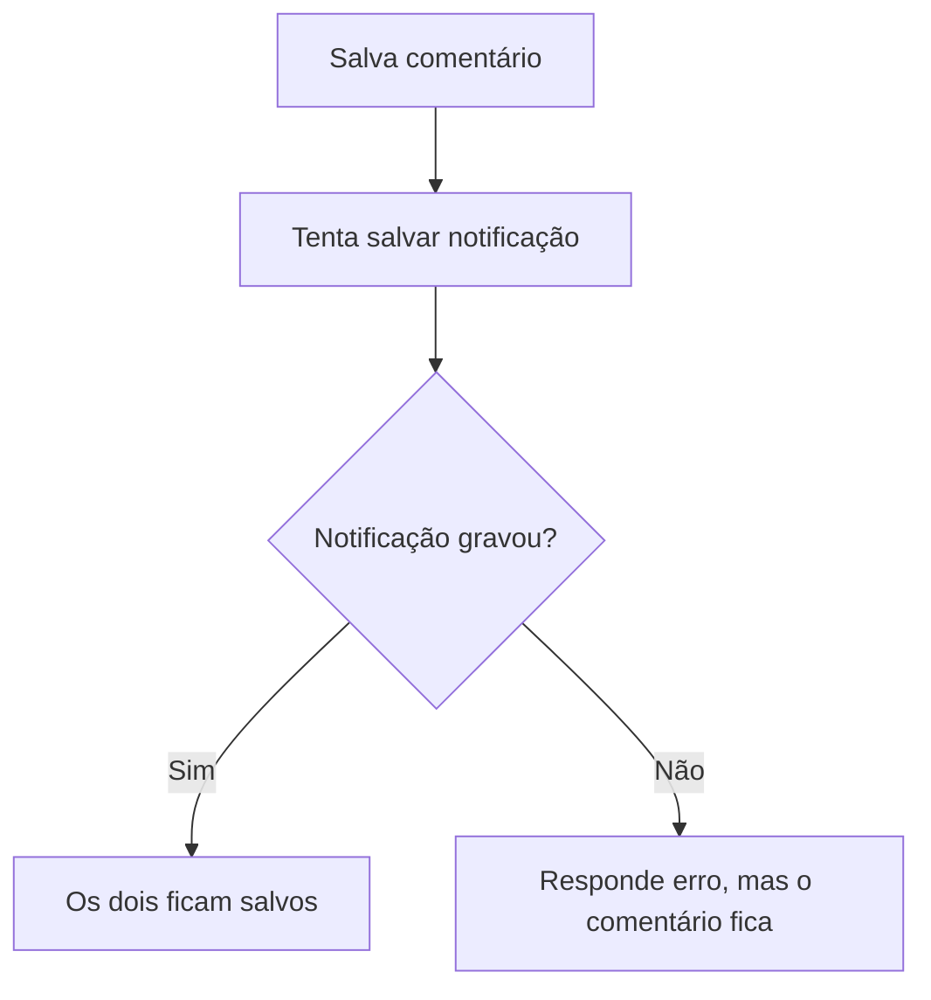
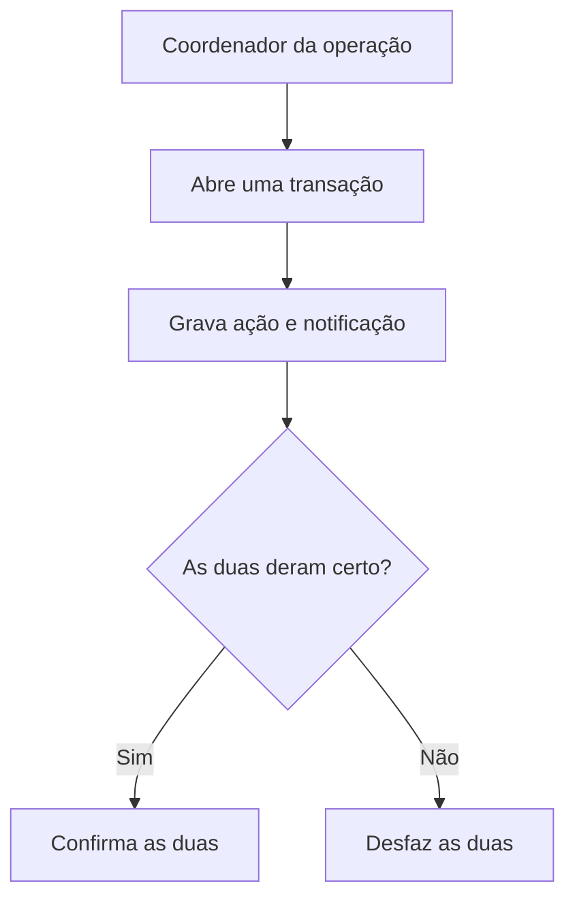

# Caso 5 aplicado: concluir a operação inteira e recuperar a limpeza das imagens

Data: 21 de novembro de 2026.

**Situação: implementado, testado e aplicado à base local.** Os casos 1 a 6 estão aplicados. Os contratos comuns estão no [Caso 6: comunicação](caso6-comunicacao-aplicada.md).

## Parte 1 - Antes

O comentário era salvo antes da notificação. Se a notificação falhasse, a resposta indicava erro, mas o comentário permanecia. Curtir e seguir também separavam a ação de sua notificação.

As imagens tinham outro problema: uma publicação rejeitada podia deixar seu upload em disco. Excluir uma publicação não tratava sua imagem. A limpeza das imagens do perfil dependia de uma tentativa imediata, sem registro durável para repetir uma falha.



## Parte 2 - Depois

Um coordenador conduz a ação e a notificação dentro da mesma transação. Publicações, contas, rede e notificações oferecem as operações necessárias por suas entradas públicas. Se uma gravação falhar antes da confirmação, o banco desfaz as gravações daquela operação.



| Antes | Mudança aplicada |
| --- | --- |
| Comentário, curtida ou seguir podiam ficar salvos sem sua notificação. | A ação e a notificação confirmam ou são desfeitas juntas. |
| Pedidos simultâneos podiam disputar uma leitura seguida de uma gravação. | As operações usam bloqueios nos registros envolvidos; as restrições de interações continuam no banco. |
| Compartilhar lia o número, somava e salvava. | O banco incrementa o contador, inclusive quando o valor antigo é nulo. |
| Montar a resposta após salvar uma publicação podia falhar depois da confirmação. | A montagem da resposta de criação e edição de publicações e enquetes ocorre dentro da transação. |
| Excluir dados e remover imagens eram tarefas sem uma pendência recuperável. | A exclusão dos dados e o registro da tarefa de limpeza usam a mesma transação. |

Exemplo: se a notificação de um comentário falhar, o comentário não fica salvo. Uma nova tentativa pode concluir os dois.

## Como as imagens passaram a funcionar

O arquivo de uma publicação chega primeiro a `var/upload-staging`, fora da área pública. O servidor limita o tamanho a 3 MB e confere o tipo pela assinatura dos bytes e pelo tipo declarado. PNG, JPEG, GIF e WebP são aceitos. O nome original do cliente não define o nome definitivo.

Uma imagem aprovada recebe um identificador aleatório em `public/uploads/managed`. O arquivo definitivo precede a gravação de sua referência no banco. Se a gravação falhar, a compensação tenta remover o arquivo novo, após consultar se ele ficou referenciado.

Na troca de avatar ou capa e na exclusão de publicação ou conta, a transação registra a imagem anterior em `file_cleanup_jobs`. A remoção física ocorre depois do commit. Se o disco falhar, a tarefa conserva a tentativa e agenda outra execução. Uma falha de limpeza não transforma uma exclusão já confirmada em erro.

O servidor verifica as pendências ao iniciar e a cada minuto. A rotina também busca arquivos próprios sem referência com mais de 24 horas, para cobrir uma interrupção entre salvar o arquivo e gravar o banco. Antes de remover, confere as referências atuais em perfis e publicações. Uma imagem compartilhada permanece enquanto houver referência. Falhas de consulta ao banco suspendem a limpeza.

Somente chaves reconhecidas são aceitas. A rotina não percorre caminhos recebidos do cliente, links externos ou nomes arbitrários. Avatares e capas anteriores com nome gerado pelo sistema podem entrar na fila após a confirmação do identificador do proprietário. A varredura de órfãos se limita às novas pastas controladas; imagens antigas de publicações permanecem fora dessa varredura até um inventário específico.

## Onde ficou o código

| Arquivo dentro de `sistema` | Responsabilidade |
| --- | --- |
| `src/workflows/post-interactions.ts` | Coordena comentário, curtida e seguir com suas notificações. Não importa Express, Sequelize ou modelos. |
| `src/bootstrap/post-interactions.ts` | Conecta as operações públicas à mesma transação. |
| `src/modules/*/persistence/*interactions-repository.ts` e `notification-recorder-repository.ts` | Consultas e gravações dos respectivos módulos. |
| `src/workflows/ports/unit-of-work.ts` | Contratos da transação, inclusive o resultado da operação. |
| `src/middleware/upload.ts` | Recebimento limitado em área privada e descarte de uploads rejeitados. |
| `src/infrastructure/storage/managed-images.ts` | Validação, nome definitivo, promoção e compensação da imagem nova. |
| `src/infrastructure/storage/file-cleanup.ts` | Registro das tarefas, nova tentativa, conferência de referências e reconciliação. |
| `migrations/current/0005-file-cleanup.js` | Cria a fila pelo processo único do caso 4. |
| `migrations/current/storage-contract.json` | Estrutura esperada da nova tabela técnica. |
| `src/server.ts` | Inicia a rotina após conferir o banco. |

Os repositórios de exclusão de contas e publicações registram a limpeza na transação que remove seus dados. O fluxo do caso 1 preserva sua divisão de responsabilidades. As páginas do caso 3 continuam iguais.

## Banco local

A versão 5 acrescentou apenas `file_cleanup_jobs` e uma linha ao histórico de migrações. As estruturas e os dados anteriores foram comparados com a cópia feita antes da atualização; os quatro registros anteriores do histórico e as imagens existentes também foram preservados. Não houve comentário, curtida ou exclusão de conta real para executar os testes.

As quatro migrações ativas anteriores e os nove arquivos históricos mantiveram o conteúdo. O contrato adicional da fila entra somente no checksum da nova migração, sem invalidar as versões anteriores.

## Verificações

```powershell
npm test
npm run test:atomic:mysql
npm run test:account:mysql
npm run test:authors:mysql
npm run test:posts:mysql
npm run test:database:mysql
```

A suíte comum passou com 49 casos e subcasos. As cinco suítes MySQL executam separadamente e passaram. Os testes do caso 5 usaram instância e arquivos descartáveis e verificaram 13 cenários:

- Falha de notificação em comentário, curtida e seguir, com desfazimento e nova tentativa.
- Pedidos simultâneos de compartilhar, seguir, curtir, salvar, repostar e votar.
- Upload rejeitado por regra, tamanho, tipo declarado ou conteúdo incompatível.
- Falha nas opções da enquete ou na montagem da resposta, com desfazimento da publicação e compensação da imagem.
- Limpeza com falha no disco, tarefa persistente e retomada por outra instância da rotina.
- Imagem com outra referência ainda ativa.
- Falhas de banco e disco no perfil; alterações paralelas de campos distintos.
- Resposta perdida após um commit já confirmado: a imagem referenciada permanece.
- Exclusão de conta com falha intermediária: dados, imagens e fila são preservados pelo rollback.
- Reconciliação após interrupção, proteção de arquivos recentes e suspensão sem banco.
- Cópia da base local: somente a nova fila e a nova versão são acrescentadas.

O cenário da cópia local é opcional por `SWIFTLINE_DATABASE_SNAPSHOT`; ele foi executado nesta etapa. Os testes dos itens 1 a 4 também passaram com a nova versão.

## Limites

Banco e disco não compartilham uma transação. A solução usa uma fila durável e compensação, com verificações antes da remoção. Se a conexão se perder depois de o banco confirmar, a resposta pode falhar apesar do commit; nesse caso, a compensação preserva qualquer imagem já referenciada.

A entrega original do caso 5 preservou a alternância da API anterior. O [Caso 6: comunicação](caso6-comunicacao-aplicada.md) acrescentou estado desejado e erros comuns à API v2; os caminhos anteriores mantêm sua compatibilidade. Não houve envio ao GitHub.
