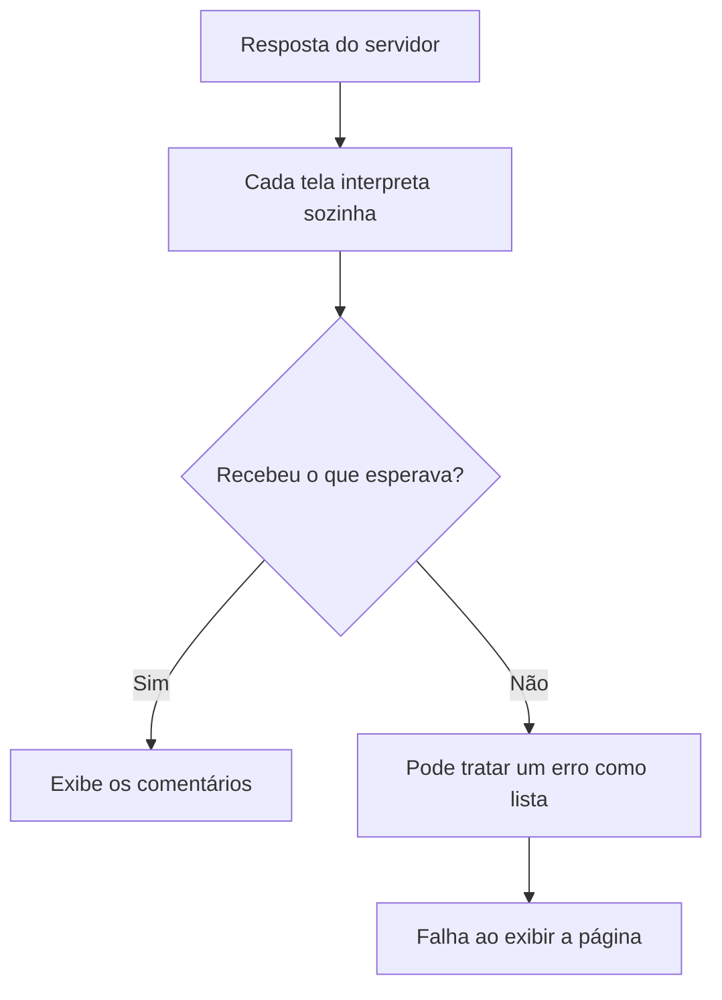
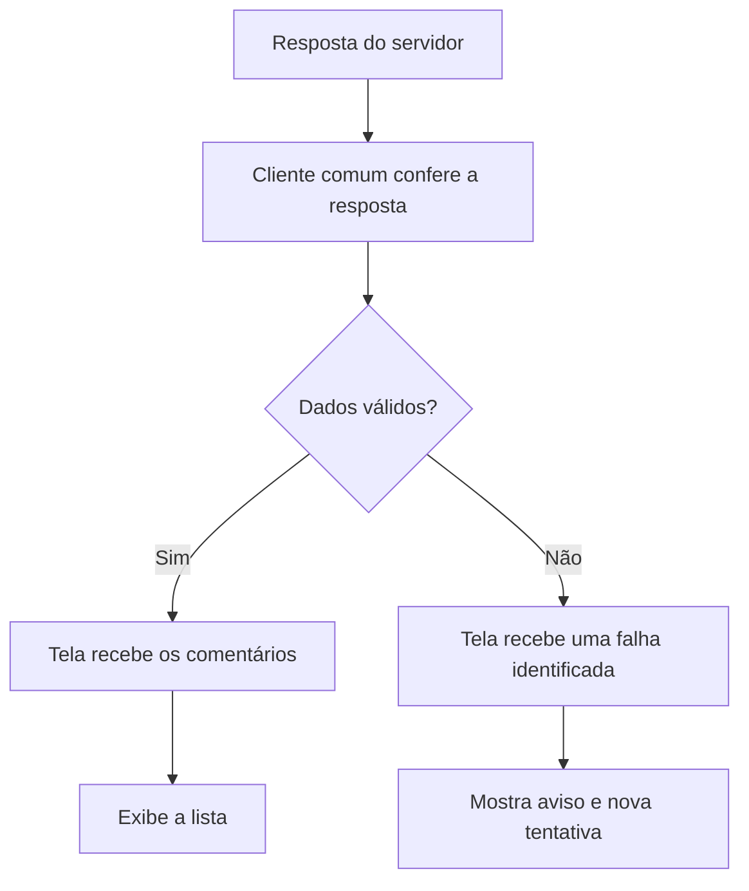

# Caso 6 aplicado: um contrato comum entre as telas e o servidor

Data: 21 de novembro de 2026.

**Situação: implementado, testado e aplicado ao banco local.** Os seis casos definidos no documento antes e depois possuem implementação e verificações próprias.

## Parte 1 - Antes

Cada tela precisava interpretar a resposta do servidor. Um erro podia chegar com `error`, com `message` ou como HTML. Uma tela que esperava comentários podia tentar usar um objeto de erro como lista e falhar.

O cliente comum entregava `Response`, e cada consumidor decidia se a resposta era um sucesso. Limites e campos também divergiam: o banco restringia o texto da publicação a 255 caracteres, enquanto a interface oferecia 280. Localização e site apareciam no perfil, mas não eram salvos.



## Parte 2 - Depois

O cliente comum confere o tipo da resposta, o código HTTP e os campos recebidos. A tela recebe dados validados ou uma falha identificada. Uma listagem inválida mostra um aviso com o botão **Tentar novamente**.



| Problema | Mudança aplicada | Resultado |
| --- | --- | --- |
| Cada tela interpretava formatos diferentes. | Um cliente HTTP e contratos comuns, com validação durante a execução. | Respostas inválidas não entram nas telas como listas. |
| Erros sem formato definido. | A API v2 entrega código, mensagem, campos inválidos quando houver e identificador do pedido. | A interface distingue o motivo da falha; erros internos não expõem SQL. |
| Sessão expirada e senha incorreta podiam receber o mesmo tratamento. | Códigos separados para sessão inválida e credenciais incorretas. | Sessão expirada volta ao login; errar a senha de exclusão conserva a sessão. |
| Texto de 280 caracteres na tela e coluna de 255 no banco. | Limite comum de 280 pontos de código Unicode, na criação, edição e pergunta da enquete; coluna `TEXT`. | A mesma regra vale no envio e na alteração, inclusive para emojis. |
| Localização e site apareciam sem persistência. | Campos no contrato, modelo, migração, gravação e resposta. | Os valores permanecem após uma nova leitura do perfil. |
| Listas inteiras em uma consulta. | Paginação no banco, com 20 itens por padrão e máximo de 50. | O botão Carregar mais busca a página seguinte. |
| Um pedido repetido podia inverter a ação anterior. | A API v2 recebe o estado desejado de curtir, salvar, repostar e seguir. | Enviar duas vezes `liked: true` mantém uma curtida. Repetir o mesmo voto confirma o voto existente. |
| Resposta de uma conversa podia chegar depois da troca de pessoa. | Cancelamento e conferência do destinatário antes de alterar a tela. | A resposta da conversa anterior não aparece na atual. |
| Recarregar Salvos podia abrir outra página. | Uma tabela comum dos endereços de navegação. | Link direto, recarregar e voltar/avançar mantêm a página correta. |

Mensagens consultam primeiro as mais recentes e aparecem em ordem de conversa. A paginação usa data e identificador para resolver empates; publicações antigas com data nula continuam acessíveis. A busca possui páginas independentes de pessoas e publicações. Um link para uma publicação antiga consulta aquela publicação diretamente.

As contagens de comentários, interações e votos usam consultas agrupadas com os identificadores presentes no resultado. Os votos das outras pessoas são contados no banco; a lista completa de votos não é carregada para montar cada página.

## Responsabilidades e arquivos

| Caminho dentro de `sistema` | Responsabilidade |
| --- | --- |
| `shared/contracts/index.ts` | Tipos de entrada e saída, limites, validação de entradas e leitura de respostas. Não depende de React, Express ou Sequelize. |
| `src/controllers/handle.ts` | Valida entradas v2 antes de chamar o serviço e adapta o resultado HTTP. |
| `src/http/api-errors.ts` | Identifica pedidos e transforma falhas da API em JSON. |
| `src/http/pagination.ts` | Limites, cursor ligado à consulta e ordenação estável. |
| `client/shared/api.ts` | Autenticação, tempo limite, cancelamento, leitura, validação e identificação de falhas. |
| `client/services/*-api.ts` | Endereços e tipos de cada funcionalidade. Entrega dados, sem repassar `Response` às telas. |
| `client/shared/use-paged-list.ts` e `AsyncStatus.tsx` | Carregamento de páginas, aviso de falha e tentativa explícita. |
| `client/features/posts` | Listas paginadas e publicações no estado compartilhado da sessão. |
| `client/App.tsx` e `client/utils/navigation.ts` | Sessão e endereços das páginas. |
| `migrations/current/0006-api-contracts.js` e `api-schema-contract.json` | Alteração de texto e campos do perfil pelo processo do caso 4. |

## Compatibilidade

A interface local usa `/api/v2`. As 39 rotas anteriores de `/api` continuam disponíveis, com o formato e a alternância anteriores nos caminhos existentes. Os dois prefixos chamam os mesmos serviços. A leitura individual de publicação foi acrescentada para os links diretos.

A API v2 usa erros como:

```json
{
  "error": {
    "code": "VALIDATION_ERROR",
    "message": "Use no máximo 280 caracteres.",
    "fields": { "content": "Use no máximo 280 caracteres." }
  },
  "requestId": "identificador-do-pedido"
}
```

O contrato de listas é `{ items, nextCursor }`. O cursor final é `null`. Falha de leitura pode ser repetida pelo botão. O transporte não repete gravações automaticamente. Perder a conexão depois de uma confirmação ainda exige conferir o resultado antes de reenviar criação de conteúdo; estado desejado não transforma toda operação em entrega única.

## Banco local e verificações

A migração 6 foi aplicada depois de passar em uma cópia da base. Acrescentou `users.location` e `users.website`, ampliou `posts.content` para `TEXT` e registrou a sexta versão. Os valores anteriores, os cinco registros anteriores do histórico e os sete arquivos de imagem foram preservados. A base continua com 21 contas e 22 publicações. Os testes de criação, exclusão e falhas usaram dados descartáveis.

A suíte comum passou com **56 casos e subcasos**, sem falhas. As seis suítes MySQL também passaram: exclusão de conta (5), autoria (7), interface compartilhada (7), migrações (10), operações e imagens (14) e contratos (12). Esses números incluem os testes principais e seus subcasos. As seis suítes são executadas separadamente da suíte comum.

O caso 6 verificou paginação com empates e datas nulas, compatibilidade, limites Unicode, perfil persistido, estado desejado, erros sem detalhes privados, entrada malformada, sessão, respostas inválidas, nova tentativa, Salvos, links antigos e troca de conversa com resposta atrasada. A cópia local da versão 5 foi atualizada e comparada com os dados anteriores.

```powershell
npm test
npm run test:contracts:mysql
```

As outras cinco suítes continuam disponíveis pelos comandos documentados no [README](../README.md). A inicialização real do servidor, as leituras v1/v2, os erros JSON e a rotina de imagens também passaram após a atualização. As evidências ficam em `test-results/case6-common-tests.txt`, `api-contracts-mysql.json`, `case6-local-database.json` e `case6-runtime-verification.json`.

O registro conclui os seis casos concretos. O mapa completo de pastas futuras do projeto e a retirada dos adaptadores antigos são etapas adicionais do plano geral. Não houve commit nem envio ao GitHub.
