# Swiftline: problemas e diagramas antes e depois

**Antes** mostra a organização de referência antes da mudança. **Depois** mostra o resultado aplicado: os seis casos foram implementados e verificados. Os diagramas simplificam as ligações e mostram os mesmos seis grupos de problemas.

## 1. Exclusão de conta: um código conhece várias partes do sistema

**Situação: aplicado e verificado.** Veja o [registro da implementação e dos testes](caso1-exclusao-conta-aplicada.md).

**Problema:** o serviço de contas consulta e apaga dados de publicações, comentários, seguidores, mensagens e notificações. Ele precisa conhecer como essas partes guardam os dados.

**Mudança aplicada:** um coordenador solicita a cada módulo que remova seus próprios dados. A exclusão mantém a transação comum no banco, garantia que já existia nesse processo.

**Para quê:** mudanças internas de mensagens ficam sob responsabilidade de mensagens. O coordenador usa a operação oferecida pelo módulo.

Os diagramas mostram publicações, mensagens e usuário para facilitar a leitura. Rede e notificações seguem a mesma divisão de responsabilidade.

**Antes — tarefas reunidas no serviço de contas**

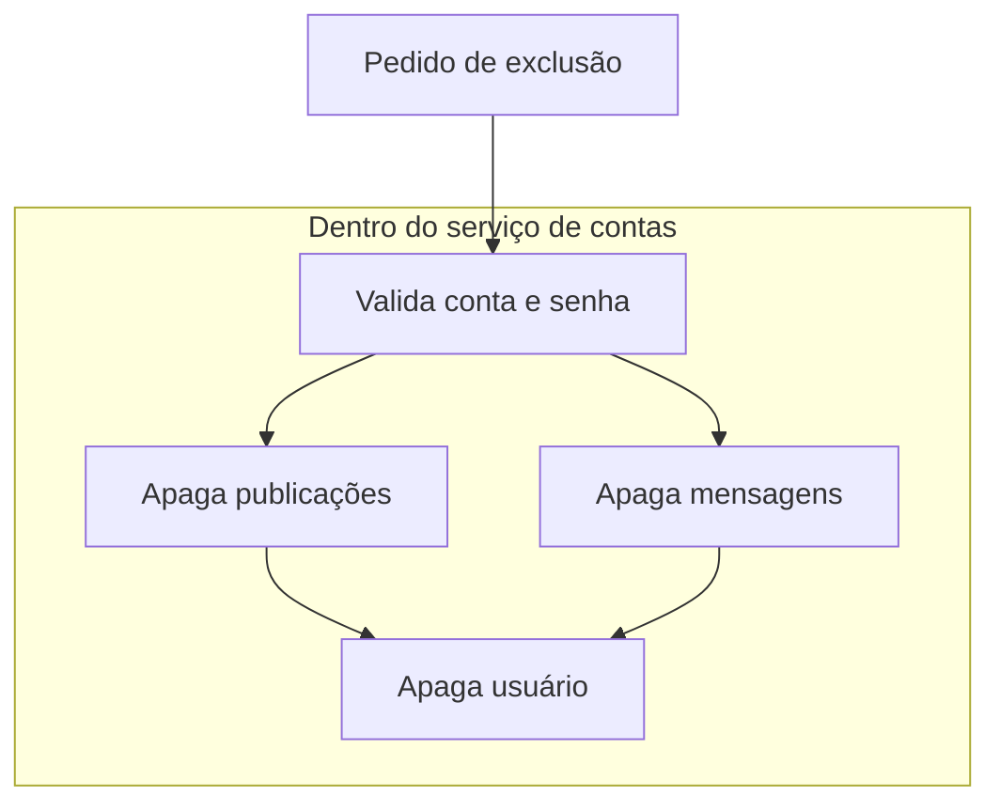

**Depois — cada módulo remove seus dados**

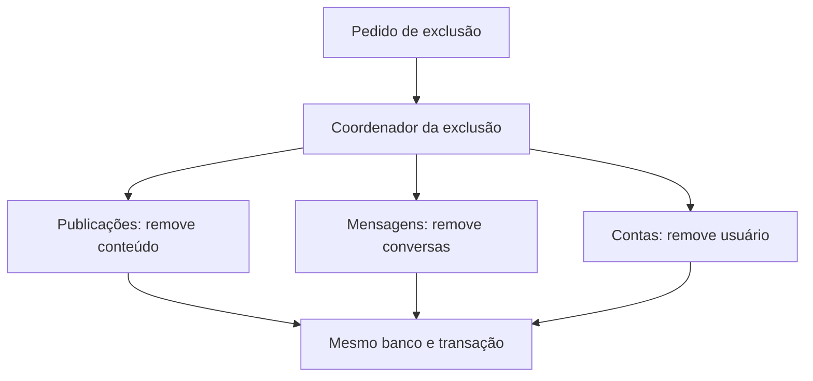

## 2. Alteração do perfil: nome e foto estão copiados nas publicações

**Situação: aplicado e verificado, inclusive no banco local.** Veja o [registro da implementação e dos testes](caso2-autores-perfil-aplicado.md).

**Problema:** trocar nome ou foto exige atualizar o perfil e as cópias nas publicações. A inicialização também tenta corrigir essas cópias.

**Mudança aplicada:** nome e foto ficam no perfil. A publicação guarda o identificador do autor e consulta seu perfil para exibir esses dados. As colunas antigas foram removidas das publicações, com backup para reversão.

**Para quê:** uma alteração no perfil atualiza a fonte usada pelas publicações, sem regravar cada publicação.

**Antes — atualizar o perfil e suas cópias**

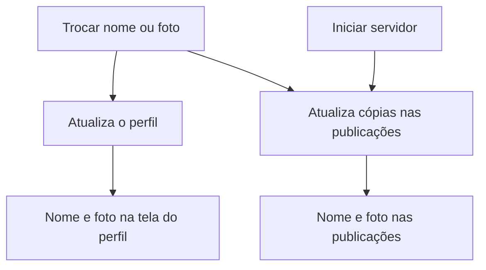

**Depois — consultar os dados do autor**

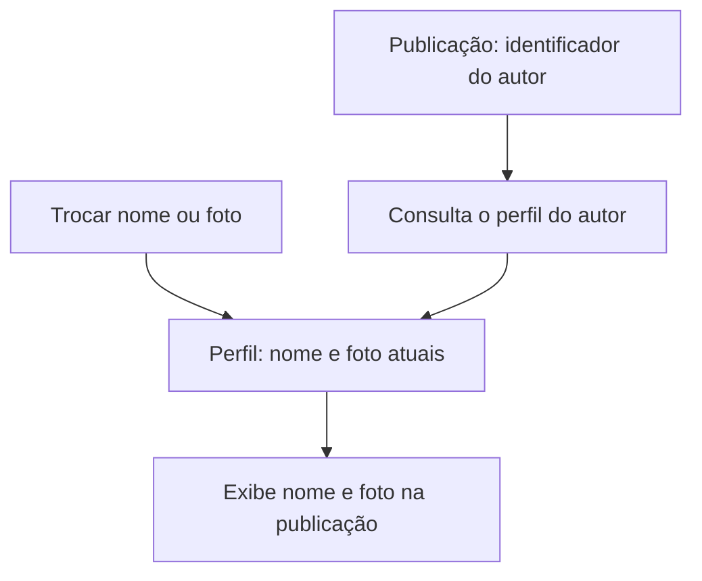

## 3. Publicações: a mesma funcionalidade tem implementações diferentes

**Situação: aplicado e verificado.** Veja o [registro da implementação e dos testes](caso3-publicacoes-compartilhadas-aplicado.md).

**Problema:** feed, perfil e salvos montam publicações por caminhos diferentes. Há diferenças na apresentação de enquetes e nas ações dos comentários.

**Mudança aplicada:** as três telas usam `PostCard`, com comentários, botões, enquete e estado compartilhado por identificador. As versões próprias do Perfil foram retiradas.

**Para quê:** corrigir ou melhorar essa implementação atende às três telas.

**Antes — cada tela monta sua publicação**

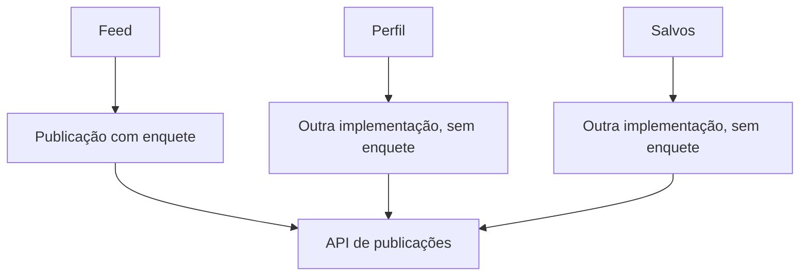

**Depois — as telas usam a mesma implementação**

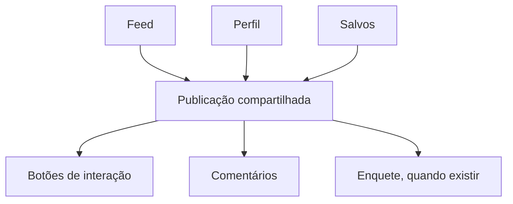

## 4. Preparação do banco: existem caminhos diferentes

**Situação: aplicado e verificado, inclusive na base local.** Veja o [registro da implementação e dos testes](caso4-banco-versionado-aplicado.md).

**Problema:** existem migrações, um script específico para a capa e código que cria tabelas ao iniciar o servidor. A preparação do banco está distribuída.

**Mudança aplicada:** `db:migrate` cria e atualiza as tabelas por uma sequência numerada. `db:adopt` confere uma base existente antes de registrá-la. Ao iniciar, o servidor apenas verifica a versão e a estrutura; não cria nem corrige tabelas.

**Para quê:** instalação e atualização seguem o mesmo procedimento.

**Antes — o início do servidor também altera o banco**

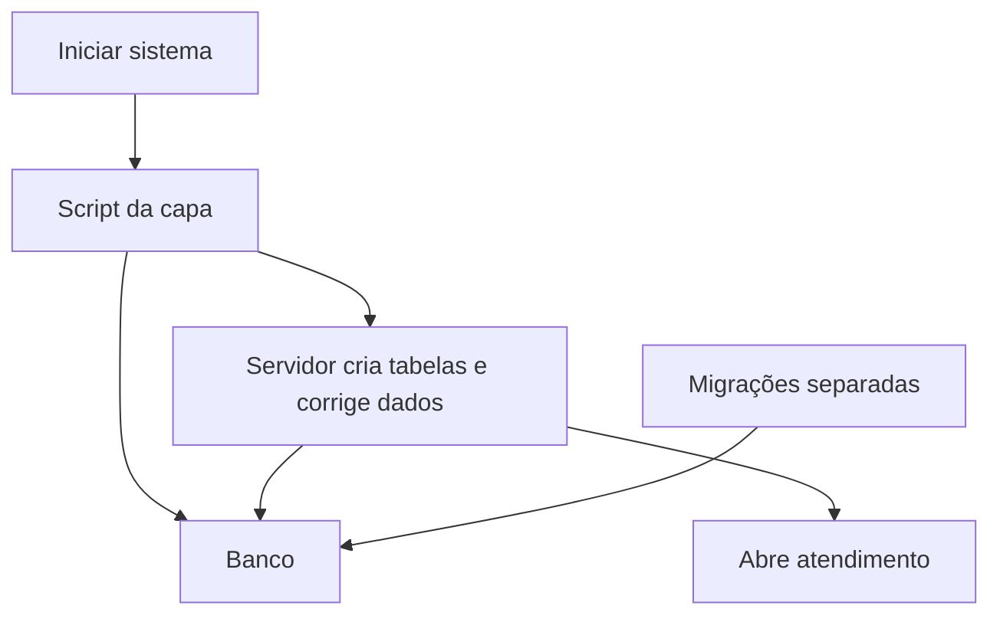

**Depois — preparar o banco e iniciar o servidor têm papéis próprios**

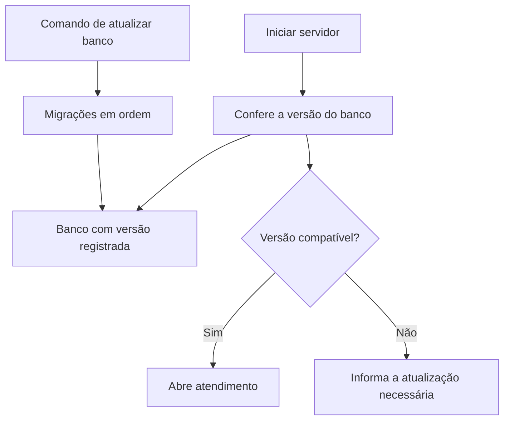

## 5. Operações incompletas: uma etapa termina e outra falha

**Situação: aplicado e verificado, inclusive a nova fila na base local.** Veja o [registro da implementação e dos testes](caso5-operacoes-e-imagens-aplicado.md).

**Problema:** um comentário pode ser gravado e sua notificação falhar depois. O pedido responde erro, mas o comentário já ficou salvo.

**Mudança aplicada:** um coordenador conduz comentário, curtida ou seguir junto da notificação, na mesma transação: confirmar as gravações ou desfazê-las juntas.

**Para quê:** impedir que esse processo deixe apenas parte da operação gravada.

As imagens novas passam por uma área privada e recebem nomes do servidor. Exclusão ou troca registra uma tarefa de limpeza na mesma transação; uma falha no disco deixa a tarefa para nova tentativa. A rotina confere referências e recupera arquivos próprios antigos sem uso. Os diagramas abaixo mostram o caso do comentário.

**Antes — a falha da notificação deixa o comentário salvo**

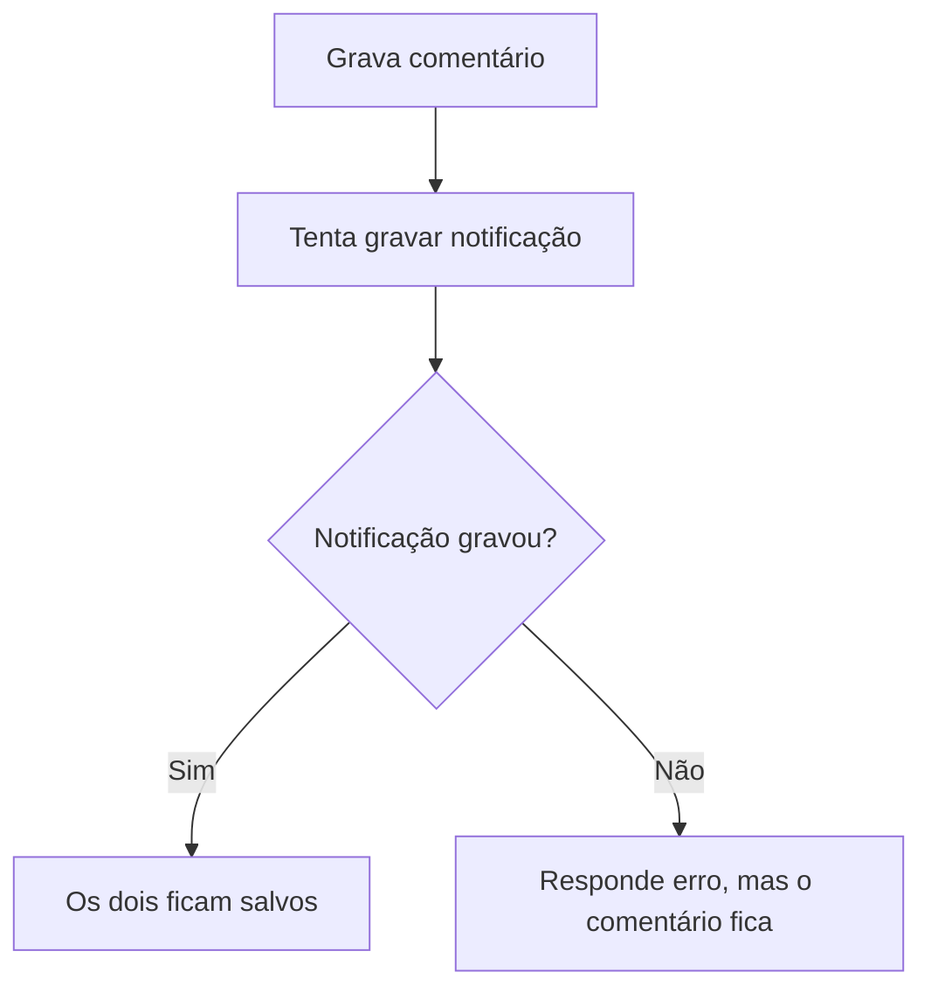

**Depois — confirmar ou desfazer a operação inteira**

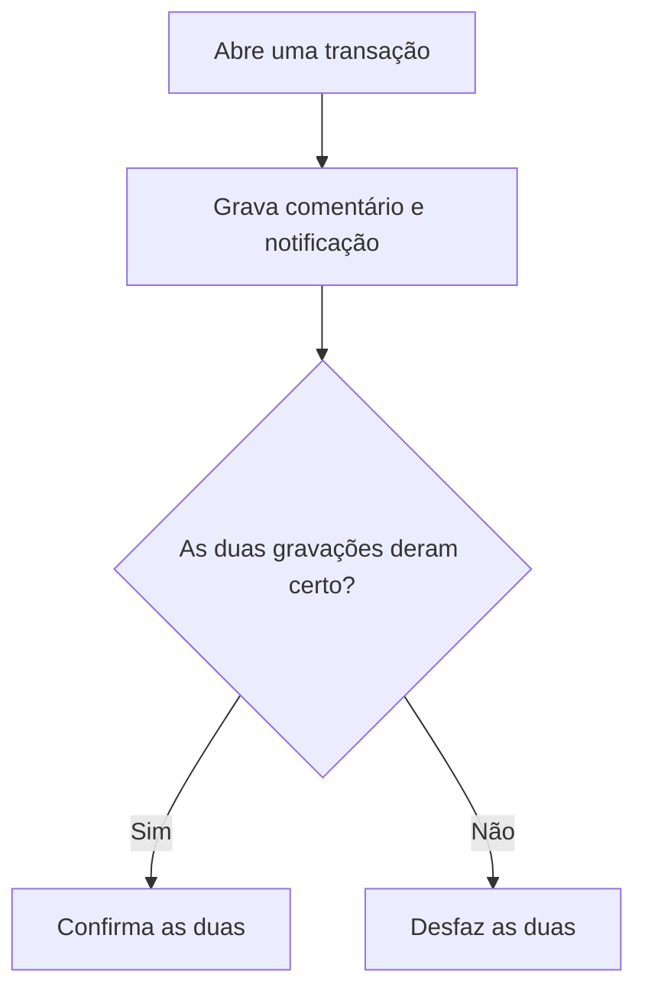

## 6. Comunicação: as telas recebem respostas diferentes para erros

**Situação: aplicado e verificado, inclusive na base local.** Veja o [registro da implementação e dos testes](caso6-comunicacao-aplicada.md).

**Problema:** há erros com `error`, outros com `message` e falhas que podem devolver HTML. Uma tela pode tratar um erro como uma lista de comentários e falhar ao exibir a página.

**Mudança aplicada:** a API v2 usa um formato de erro comum. O cliente HTTP valida as respostas e entrega dados ou uma falha identificada às telas. Os contratos alinham campos, limites e paginação entre a interface e o servidor; a migração ajustou o texto e os campos do perfil no banco.

**Para quê:** a tela recebe dados válidos ou uma falha identificada e pode oferecer nova tentativa.

**Antes — a tela tenta usar respostas diferentes como lista**

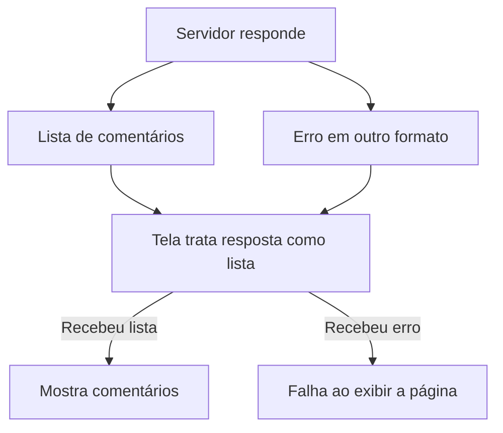

**Depois — uma função comum separa sucesso e erro**

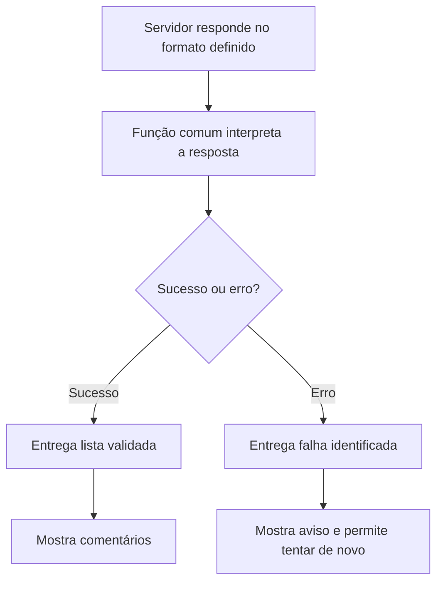

## Referências no projeto

Os casos se apoiam no [diagnóstico](diagnostico-arquitetura-20261120.md) e no [projeto da arquitetura](projeto-reengenharia-arquitetural.md). O grupo 1 usa a exclusão de conta como exemplo da divisão de responsabilidades. Os demais correspondem aos dados do autor, interface compartilhada, preparação do banco, coordenação das operações e contratos de comunicação.
