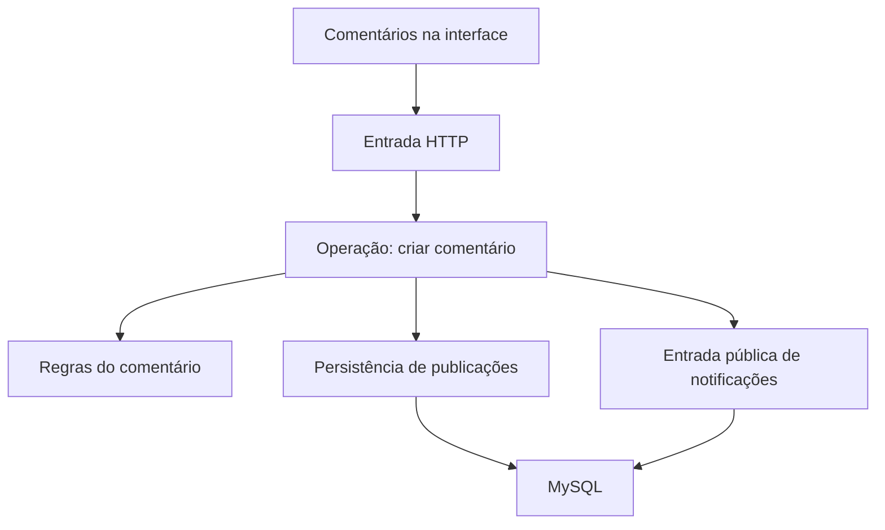
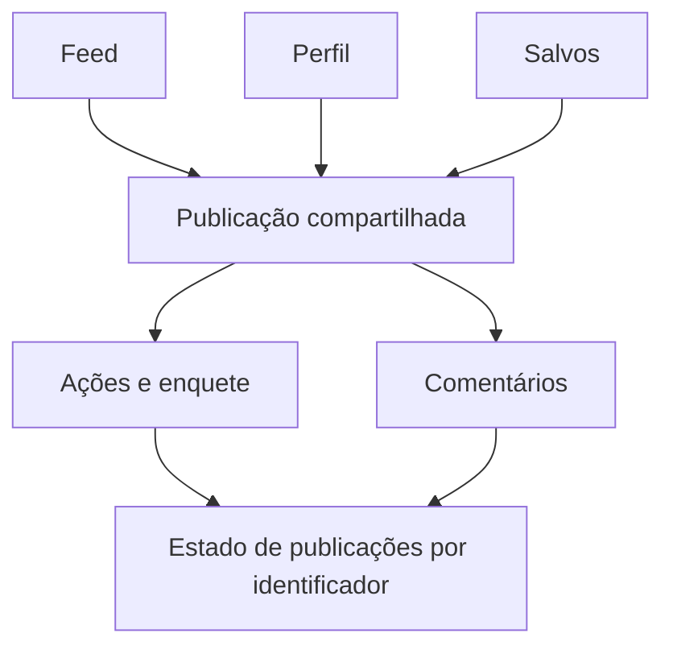

# Projeto de reengenharia arquitetural do Swiftline

Data: 20 de novembro de 2026.

**Situação: os seis casos concretos aplicados e verificados em 21 de novembro de 2026.** A parte 1 registra o código de referência após a organização inicial dos arquivos e antes da aplicação dos casos. A parte 2 descreve o resultado proposto para o conjunto. As implementações estão registradas em [Caso 1: exclusão de conta](caso1-exclusao-conta-aplicada.md), [Caso 2: dados do autor](caso2-autores-perfil-aplicado.md), [Caso 3: publicação compartilhada](caso3-publicacoes-compartilhadas-aplicado.md), [Caso 4: banco versionado](caso4-banco-versionado-aplicado.md), [Caso 5: operações e imagens](caso5-operacoes-e-imagens-aplicado.md) e [Caso 6: comunicação](caso6-comunicacao-aplicada.md). O mapa completo de pastas futuras continua como projeto; a conclusão dos seis casos não representa a migração de todos os serviços para esse destino.

Os seis grupos de problemas também estão em [Problemas com diagramas antes e depois](problemas-antes-depois-diagramas.md), com a proposta logo abaixo de cada caso.

O objetivo é definir quem cuida de cada funcionalidade, quem pode alterar cada conjunto de dados e por onde as operações devem passar. O Swiftline continuará com uma interface React, uma aplicação Node/Express e um banco MySQL. A proposta usa módulos dentro da mesma aplicação: um **monólito modular**.

## Parte 1 — Antes: arquitetura atual

### 1. O que já existe

As telas já estão em arquivos separados. O servidor já tem rotas, controladores e serviços. Essa organização facilitou localizar o código, mas algumas responsabilidades continuam misturadas.

| Parte atual | O que acontece no código | Consequência arquitetural |
| --- | --- | --- |
| Serviços do servidor | Recebem partes do objeto `Request` do Express, executam regras, consultam modelos Sequelize e escolhem códigos HTTP. | A regra de uma funcionalidade depende do transporte HTTP e da forma de acessar o banco. |
| Dados do autor | Nome e avatar ficam no usuário e também em cada publicação. A edição do perfil atualiza as cópias; a inicialização tenta repará-las. | Perfil, publicações e inicialização dividem a responsabilidade pelos mesmos dados. |
| Publicações na interface | Feed, perfil e salvos montam publicações por caminhos diferentes. Há duas implementações de comentários e de ações. | Uma mudança na publicação pode alcançar apenas algumas telas. A auditoria encontrou diferenças em enquetes e edição de comentários. |
| Banco e inicialização | Há oito migrações, um script específico para a capa e `sequelize.sync()` ao iniciar. | A criação e a atualização do banco seguem processos diferentes. |
| Operações com várias gravações | Algumas já usam transação, como criar publicação com enquete e excluir conta. Comentário com notificação e curtida com notificação seguem passos separados. | Falhas intermediárias podem deixar apenas parte da operação gravada. |
| Banco e imagens | Publicações usam upload em disco; imagens de perfil têm outro tratamento. Não há um responsável comum pelo ciclo do arquivo. | Uma operação rejeitada ou uma exclusão pode deixar arquivos sem uso. |
| Comunicação com a interface | Há respostas com `error`, outras com `message`, e falhas inesperadas podem responder HTML. O cliente comum devolve `Response`. | Cada tela precisa decidir como interpretar sucesso, falha e sessão inválida. |

Esses pontos formam **seis frentes arquiteturais**: responsabilidades, dados, interface compartilhada, evolução do banco, coordenação de operações e contratos de comunicação. São frentes de trabalho, não uma contagem de todos os defeitos possíveis.

### 2. Exemplo atual: comentar uma publicação

O controlador chama `createComment` em `src/services/comments-service.ts`. A função recebe `req`, lê o identificador da publicação, consulta o modelo, grava o comentário, grava a notificação e devolve dados com um código HTTP.

Na reprodução controlada da auditoria, a gravação do comentário ocorreu, a notificação falhou e a API respondeu erro. O fluxo não tinha uma transação comum para as duas gravações.

### 3. Base do diagnóstico

| Frente | Evidência principal no código atual | Registro do diagnóstico |
| --- | --- | --- |
| Responsabilidades | `src/types/service.ts`, `src/controllers/handle.ts`, `src/services/posts-service.ts` | P01 |
| Dados do autor | `src/models/Post.ts`, `src/services/profile-service.ts`, `src/server.ts` | P02 |
| Interface compartilhada | `client/pages/Feed.tsx`, `client/pages/SavedPosts.tsx`, `client/components/profile/ProfileComments.tsx` | P03 |
| Evolução do banco | `src/server.ts`, `scripts/apply-cover-local.mjs`, `migrations`, `package.json` | P04 |
| Coordenação de operações | `src/services/comments-service.ts`, `src/services/posts-service.ts`, `src/middleware/upload.ts` | P05 e P06 |
| Contratos de comunicação | `client/services/api.ts`, `src/models/Post.ts`, `src/middleware/payload-error.ts` | P07 e P08 |

O [diagnóstico detalhado](diagnostico-arquitetura-20261120.md) registra as evidências e os limites das verificações. As reproduções usaram dependências controladas. Não houve conferência do esquema de um MySQL real nesta etapa.

## Parte 2 — Depois: arquitetura proposta

### 4. Divisão por funcionalidade

Cada módulo terá uma entrada pública para os outros módulos e partes internas para HTTP, operações, regras e persistência. Uma entrada pública é um conjunto pequeno de funções e tipos exportados por `public.ts`.

| Módulo futuro | Responsabilidade | Modelos atuais sob sua responsabilidade | Operações oferecidas aos demais |
| --- | --- | --- | --- |
| `accounts` — contas | Cadastro, autenticação, perfil e dados da conta. | `User` | Consultar perfil público, consultar existência do usuário e validar credenciais. |
| `posts` — publicações | Publicações, comentários, enquetes e interações com publicações. | `Post`, `Comment`, `CommentLike`, `Like`, `Repost`, `SavedPost`, `PostView`, `PollOption`, `PollVote` | Consultar publicações prontas para exibição e remover conteúdo de uma conta. |
| `network` — rede de pessoas | Seguir, deixar de seguir e consultar relações. | `Follow` | Consultar pessoas seguidas e estado da relação. |
| `messages` — mensagens | Envio e consulta de conversas. | `Message` | Remover mensagens de uma conta durante sua exclusão. |
| `notifications` — notificações | Registrar, listar e marcar notificações como lidas. | `Notification` | Registrar uma notificação dentro da operação em andamento. |
| `discovery` — busca e notícias | Reunir resultados de busca e obter notícias e tendências externas. | Nenhum modelo próprio atual. | Entregar resultados de busca, notícias e tendências. |

Os treze modelos atuais estão contemplados nessa divisão. Tabelas técnicas futuras, como o histórico de migrações e as tarefas de remoção de arquivos, pertencem à infraestrutura.

**Regra de propriedade:** somente a persistência do módulo responsável altera suas tabelas. Um módulo solicita uma operação ao outro por sua entrada pública; não importa seu controlador, seu repositório interno ou seus modelos para fazer a alteração por conta própria.

### 5. Responsabilidade dentro de um módulo

| Parte | Faz | Exemplo em publicações |
| --- | --- | --- |
| `http` | Lê parâmetros e autenticação, valida o formato recebido e transforma resultados em respostas HTTP. | Lê o texto de um comentário e chama a operação de comentar. |
| `application` | Conduz uma operação completa e define quais gravações devem ocorrer juntas. | Confere a publicação, aplica regras e coordena comentário e notificação. |
| `domain` | Define regras da funcionalidade com dados simples. | Verifica se o comentário tem conteúdo e se o usuário pode editar. |
| `persistence` | Executa consultas e gravações com Sequelize; devolve dados simples. | Busca uma publicação ou grava um comentário na transação recebida. |
| `public.ts` | Expõe somente as operações e os tipos necessários a outros módulos. | Oferece uma consulta de publicações para a busca. |

Uma **operação da aplicação**, também chamada de caso de uso, é uma ação completa, como `create-comment`, `update-profile` ou `delete-post`. Um **repositório** reúne as consultas e gravações necessárias a essas ações. Ele terá operações específicas; não será uma cópia genérica de todos os métodos do Sequelize.

As operações da aplicação recebem dados como `{ actorId, postId, content }`. Elas devolvem dados ou falhas identificadas, como `POST_NOT_FOUND`. O código HTTP correspondente fica no adaptador HTTP.

O Express fica em `http` e na inicialização. Sequelize, SQL, disco e provedores externos ficam nas implementações de persistência e infraestrutura. `application` depende de interfaces pequenas para usar esses recursos; `domain` depende apenas de regras e tipos simples. `bootstrap` conecta as interfaces às implementações.

### 6. Exemplo projetado: comentar uma publicação

As duas gravações usam a mesma transação. O diagrama mostra o caminho da execução; as interfaces permitem que a operação não importe Sequelize nem Express.

| Passo | Responsável | Resultado esperado |
| --- | --- | --- |
| 1 | Entrada HTTP | Identifica o usuário autenticado e valida identificador e formato do texto. |
| 2 | Operação `create-comment` | Consulta a publicação e aplica a regra de conteúdo obrigatório. |
| 3 | Coordenador de transação | Abre uma unidade de trabalho para as gravações. |
| 4 | Publicações e notificações | Gravam o comentário e, quando necessário, a notificação na mesma transação. |
| 5 | Coordenador de transação | Confirma as duas gravações ou desfaz ambas. |
| 6 | Entrada HTTP e cliente da API | Entregam o comentário criado ou um erro padronizado para a interface. |

**Decisão:** nesta arquitetura, a notificação interna faz parte da operação de comentar, curtir ou seguir. Se sua gravação falhar, a operação é desfeita. Como tudo usa o mesmo banco, isso pode ocorrer na mesma transação. Um envio externo futuro, como e-mail, precisará de outro processo de entrega.

### 7. Ligações permitidas entre módulos

| Quem solicita | Pode solicitar | Motivo |
| --- | --- | --- |
| Contas | Recursos de senha, token e armazenamento de imagens. | Cuidar da conta e do perfil. |
| Notificações | Consulta pública de contas. | Exibir os dados públicos de quem realizou a ação. |
| Rede de pessoas | Consulta pública de contas e registro de notificações. | Validar a relação e avisar a pessoa seguida. |
| Publicações | Consultas de contas e rede; registro de notificações; armazenamento de imagens. | Exibir autores, montar o feed e executar interações. |
| Mensagens | Consulta pública de contas. | Validar o destinatário e exibir participantes. |
| Busca e notícias | Consultas públicas de contas e publicações; provedores externos. | Reunir dados sem assumir a gravação dos dados dos outros módulos. |
| Fluxo de exclusão de conta | Operações de limpeza dos módulos envolvidos. | Coordenar a exclusão completa sem concentrar SQL de todas as tabelas em contas. |

A composição das consultas poderá usar uma leitura em lote dos perfis dos autores para evitar uma consulta por publicação. Os modelos Sequelize não serão devolvidos pelas entradas públicas.

`src/workflows/delete-account.ts` será responsável pelo fluxo que atravessa módulos: validar a confirmação, limpar interações e conteúdo, limpar relações, mensagens e notificações, excluir a conta e registrar tarefas de limpeza de arquivos. Todas as gravações de banco usam a mesma transação. Cada módulo remove seus próprios registros. As chaves estrangeiras e a ordem das exclusões serão conferidas no banco de teste.

Os módulos não importam esse fluxo de volta. A rota de exclusão chama o fluxo por uma dependência fornecida na inicialização. Assim, a coordenação não cria uma dependência circular entre contas e publicações.

### 8. Dados com um responsável definido

| Dado | Fonte definitiva proposta | Mudança |
| --- | --- | --- |
| Nome, avatar, capa e biografia | Conta do usuário. | Atualizar o perfil grava esses dados uma vez. |
| Autor da publicação | `Post.userId`, ligado ao usuário. | A consulta monta `author` e `avatar` para a resposta. As cópias armazenadas na publicação deixam de orientar a exibição. |
| Texto, imagem e enquete | Publicações. | Criar e editar usam as mesmas regras de conteúdo. |
| Curtidas, republicações, salvos, visualizações e votos | Registros das respectivas interações. | A consulta calcula os estados e contagens necessários à página. O campo duplicado `Post.likes` deixa de ser a fonte da contagem. |
| Compartilhamentos | Contador da publicação. | A persistência usa incremento atômico, em vez de ler, somar e salvar. |
| Estado de seguir | Rede de pessoas. | A interface recebe o estado real e não presume que todas as relações começam vazias. |

O comportamento atual já tenta manter nome e avatar antigos iguais ao perfil atual. A proposta mantém essa intenção: publicações antigas exibem o perfil atual. As mensagens textuais históricas das notificações podem permanecer como o registro da ação; nome e avatar exibidos junto delas vêm da conta.

`Post.author` e `Post.avatar` foram retirados no caso 2 após a troca dos leitores e escritores, com backup para reversão. Os campos `author` e `avatar` continuam nas respostas, obtidos do perfil atual. A leitura de curtidas já usa a contagem de `Like` no caso 5; a retirada física de `Post.likes` continua como proposta posterior. Registros sem usuário válido impedem a migração das colunas de autoria até sua conferência.

### 9. Interface com uma implementação de publicação

**Aplicado no caso 3.** Feed, Perfil e Salvos já usam a entrada pública `client/features/posts`, o mesmo `PostCard` e o estado comum por identificador. As chamadas HTTP existentes permanecem em `client/services`; a migração completa dos contratos continua projetada. O [registro do caso 3](caso3-publicacoes-compartilhadas-aplicado.md) detalha o alcance e os testes.

`PostCard` reúne a apresentação da publicação. `PostActions`, `PostPoll` e `Comments` pertencem ao mesmo módulo de interface. As páginas escolhem quais publicações listar; as permissões recebidas e verificadas pelo servidor determinam quais ações podem ocorrer. Variações de aparência são parâmetros explícitos do componente.

O estado compartilhado guarda publicações por identificador e listas de identificadores por consulta. Assim, uma alteração atualiza a mesma publicação no feed, no perfil e em salvos. Remover um item dos salvos muda essa lista; não apaga a publicação do feed.

| Responsável na interface | Papel proposto |
| --- | --- |
| `app/session` | Controlar sessão, usuário atual e saída da conta. Uma resposta identificada como `SESSION_INVALID` encerra a sessão; uma senha incorreta em outra operação não encerra a sessão automaticamente. |
| `app/routes` | Manter uma tabela de endereços usada ao navegar, recarregar, voltar e avançar. |
| `features/posts` | Componentes, chamadas e estado de publicações e comentários. |
| `features/network` | Consultar e atualizar as relações de seguir por usuário. |
| `features/messages` | Guardar histórico por conversa e ignorar respostas de uma seleção anterior. |
| `shared/api` | Enviar pedidos, interpretar respostas e devolver dados tipados ou erros conhecidos. |
| `shared/ui` | Componentes visuais gerais, como avatar e aviso de lista vazia. |

Os componentes de perfil deixam de manter versões próprias das regras de publicação e comentário. O estado pode usar recursos do React já presente no projeto; a proposta não exige uma nova biblioteca de estado.

### 10. Contratos de comunicação

**Aplicado no caso 6.** Veja o [registro específico](caso6-comunicacao-aplicada.md).

`shared/contracts`, fora de `client` e `src`, reúne os tipos de entrada e saída, limites comuns e validadores usados nas fronteiras. Esse código não importa React, Express ou Sequelize. Tipos TypeScript ajudam na compilação; validadores conferem os dados recebidos durante a execução. O servidor continua responsável pela autorização e pelas regras da operação.

| Contrato | Decisão aplicada |
| --- | --- |
| Texto de publicação | Até 280 caracteres, inclusive ao criar, editar e alterar a pergunta da enquete. O limite conta pontos de código Unicode após retirar espaços das extremidades. O banco usa `TEXT`; a regra do servidor aplica o limite. |
| Campos do perfil | Nome, biografia, avatar, capa, localização e site têm entrada, validação, persistência e resposta definidas. Localização e site, já oferecidos na tela, receberam suporte no modelo e na migração 6. |
| Enquete | De duas a quatro opções, até 80 caracteres por opção, com uma regra comum de comparação e validação. |
| Imagens | Até 3 MB por imagem, com formato e conteúdo validados no servidor. A infraestrutura adapta os formatos de envio atuais ao mesmo processo de armazenamento. |
| Resultado de publicação | Um `PostView` com dados públicos do autor, interações e permissões. As telas não recebem instâncias Sequelize. |
| Listagens | Página padrão de 20 itens, máximo de 50, cursor opaco e ordenação estável por data e identificador. Mensagens são paginadas a partir das mais recentes e apresentadas na ordem da conversa. |
| Erro | `{ error: { code, message, fields? }, requestId }`, sempre em JSON na API. Falhas internas não expõem SQL nem detalhes privados. |
| Resultado paginado | `{ items, nextCursor }`. Quando não houver outra página, `nextCursor` é `null`. |

As novas respostas são oferecidas sob `/api/v2`. Os caminhos correspondem aos atuais, com o novo prefixo; por exemplo, `/api/v2/posts` e `/api/v2/posts/:id/comments`. Os adaptadores temporários de `/api` preservam os 39 endereços e métodos atuais durante a migração. Cada rota usa a mesma operação interna; os prefixos usam as mesmas regras.

A interface local usa a API v2. Depois que todos os consumidores conhecidos usarem o novo contrato e os testes passarem, os adaptadores antigos podem ser retirados. A paginação limita as consultas da API nova; a resposta antiga continua como compatibilidade temporária e não serve como critério de conclusão dessa melhoria.

O adaptador HTTP mapeia validação para 400, sessão inválida para 401, falta de permissão para 403, ausência de registro para 404, conflito para 409, excesso de tamanho para 413, formato de mídia inválido para 415, falha interna para 500 e indisponibilidade externa para 503. Códigos de falha distintos separam sessão inválida de credenciais incorretas.

### 11. Transações, concorrência e arquivos

**Aplicado no caso 5.** `AtomicUnitOfWork` conduz comentário, curtida e seguir com suas notificações. Os coordenadores usam operações públicas dos módulos; os repositórios compartilham a transação Sequelize. A transação não aparece como `Sequelize.Transaction` nos contratos dos coordenadores. O fluxo de exclusão do caso 1 mantém seu contrato e agora registra as tarefas de limpeza dentro da mesma transação. As operações que permanecem nos serviços de publicações e enquetes usam suas transações locais.

| Situação | Coordenação aplicada e contrato ainda projetado |
| --- | --- |
| Comentário, curtida ou relação com notificação | Uma transação para a ação e sua notificação. |
| Publicação com enquete | Uma transação para publicação e opções, preservando a garantia que já existe. |
| Voto e interações únicas | Restrições de unicidade conferidas no banco, bloqueios dos registros envolvidos e resposta de conflito para voto repetido. |
| Pedidos simultâneos de compartilhar | Incremento atômico no banco. |
| Pedidos repetidos de curtir, salvar ou seguir | A API v2 recebe o estado desejado, como `{ liked: true }`; repeti-lo mantém esse estado. A API anterior preserva sua alternância. |
| Exclusão de publicação ou conta | Registros dependentes e tarefa de limpeza de arquivos gravados na mesma transação. |

O disco não participa da transação MySQL. O armazenamento agora usa compensação e recuperação explícitas:

1. Receber o arquivo em área temporária privada, com limite de tamanho, e validar seu conteúdo.
2. Aplicar as regras da operação e preparar o arquivo com uma chave gerada pelo servidor.
3. Colocar o arquivo no armazenamento definitivo antes de confirmar a referência no banco.
4. Se a gravação no banco falhar, tentar remover o novo arquivo. Uma rotina posterior reconcilia arquivos novos sem referência, após 24 horas, caso o processo pare nessa etapa.
5. Ao substituir ou excluir um arquivo, gravar uma tarefa em `file_cleanup_jobs` junto da alteração de banco. Após o commit, tentar a remoção. Se falhar, a tarefa permanece para nova tentativa.

A rotina de limpeza executa no mesmo serviço Node, ao iniciar e a cada minuto, com retomada de tarefas pendentes e remoção repetível. As imagens novas usam `public/uploads/managed`; a área temporária fica em `var/upload-staging`, fora da área pública. A rotina só trata chaves reconhecidas, confere referências e suspende a limpeza quando não consegue consultar o banco. A varredura de órfãos usa 24 horas de espera. Avatares e capas anteriores com chave do proprietário podem entrar na fila durante a operação; imagens antigas de publicações exigem inventário antes da varredura. URLs recebidas do cliente não viram caminhos de remoção. Uma conexão perdida após um commit já concluído preserva imagens referenciadas. O [registro do caso 5](caso5-operacoes-e-imagens-aplicado.md) detalha as verificações e os limites.

### 12. Banco, configuração e inicialização

**Preparação e inicialização separadas no caso 4.** O servidor conecta e verifica a versão e a estrutura antes de abrir o atendimento. Uma versão incompatível impede a abertura e indica a atualização necessária. A inicialização não cria tabelas nem atualiza publicações antigas.

A sequência atual instala as 13 tabelas em um banco vazio e permite adotar uma base existente compatível:

| Passo | Banco vazio | Banco existente |
| --- | --- | --- |
| Conferir a base | Criar um esquema inicial completo, com tabelas, índices e relacionamentos. | Inspecionar estrutura, índices e dados incompatíveis, sem deduzir o esquema apenas dos modelos. |
| Registrar a versão inicial | Executar a migração inicial. | Registrar a versão inicial somente depois de comprovar equivalência; corrigir divergências antes. |
| Atualizar | Executar migrações posteriores em ordem. | Executar as mesmas migrações posteriores em ordem. |
| Conferir | Comparar a estrutura produzida e executar os testes. | Fazer a atualização em uma cópia e comparar a estrutura e os dados preservados. |

Os nove arquivos anteriores, inclusive o acrescentado no caso 2, foram preservados em `migrations/history`, fora da sequência atual. `migrations/current` contém o esquema inicial e as etapas de capa, enquetes e autoria. `db:status` consulta a versão; `db:migrate` instala ou atualiza; `db:adopt` registra uma base existente após conferir estrutura e referências. Os arquivos e seus resultados são registrados em `swiftline_schema_migrations`. Uma trava no banco impede duas atualizações simultâneas.

Os scripts específicos da capa e dos autores foram retirados; suas tarefas pertencem à sequência. `sync()` saiu da inicialização e da preparação dos testes MySQL. A base local foi adotada após o teste em cópia: suas 15 tabelas anteriores mantiveram estruturas e dados, e a tabela do novo histórico foi adicionada. Alterações de estrutura no MySQL exigem cópia de segurança e plano de recuperação; não se presume que todo DDL possa ser desfeito por uma transação. O [registro do caso 4](caso4-banco-versionado-aplicado.md) detalha os comandos, as verificações e os limites.

A leitura dos parâmetros do banco já é comum ao servidor e aos comandos, com validação de nome e porta. A API agora atribui identificadores aos pedidos no caso 6. A centralização das demais configurações e da raiz de armazenamento continua projetada.

### 13. Mapa das pastas propostas

Este é o destino dos arquivos, não uma mudança já aplicada. Os demais arquivos da raiz de `sistema`, os recursos visuais e os resultados de compilação continuam com seus papéis próprios.

| Caminho futuro dentro de `sistema` | Conteúdo e origem principal |
| --- | --- |
| `client/app` | Composição de `App.tsx`, sessão, navegação e estrutura geral da interface. |
| `client/pages` | Telas que compõem as funcionalidades, sem repetir as regras dos componentes. |
| `client/features/accounts` | Login, cadastro e edição de perfil. |
| `client/features/posts` | `PostCard`, ações, enquetes, comentários, API e estado das publicações. |
| `client/features/network` | Relações e sugestões de pessoas. |
| `client/features/messages` | Conversas, histórico e envio de mensagens. |
| `client/features/notifications` | Listagem e leitura de notificações. |
| `client/features/discovery` | Busca, notícias e tendências. |
| `client/shared` | Cliente HTTP e componentes visuais gerais. |
| `client/styles` e `client/assets` | Estilos e recursos visuais existentes. |
| `shared/contracts` | Tipos, limites e validação das entradas e saídas da API. |
| `src/modules/accounts` | Regras e operações hoje em autenticação, perfil, conta e usuários. |
| `src/modules/posts` | Publicações, comentários, enquetes, permissões e consultas de atividade. |
| `src/modules/network` | Operações hoje em `follow-service`. |
| `src/modules/messages` | Operações hoje em `messages-service`. |
| `src/modules/notifications` | Operações hoje em `notifications-service`. |
| `src/modules/discovery` | Busca e coordenação das integrações externas. |
| `src/workflows` | Operações que atravessam vários módulos, como excluir conta. |
| `src/infrastructure` | Configuração, conexão, modelos e associações Sequelize, transações, armazenamento e clientes de provedores externos. |
| `src/bootstrap` | Montagem das dependências, aplicação Express e inicialização. |
| `migrations` e `scripts` | Histórico, sequência executável de migrações e comandos de manutenção explícitos. |
| `public/uploads` | Arquivos definitivos servidos pela aplicação. A área temporária fica fora de `public`. |
| `tests` | Verificações de regras, contratos, fronteiras, MySQL e fluxos da interface. |
| `docs` | Diagnóstico, este projeto e evidências da aplicação futura. |

Dentro de cada `src/modules/<nome>`, a estrutura prevista é `http`, `application`, `domain`, `persistence` e `public.ts`. Os modelos físicos ficam reunidos em `src/infrastructure/database/models` para registrar relacionamentos; somente os repositórios autorizados de cada módulo os usam. O arquivo que registra associações e a composição da inicialização são exceções explícitas a essa regra de importação.

Para a interface, as páginas usam as entradas públicas das funcionalidades; uma funcionalidade não importa a página que a utiliza. `shared/contracts` não importa código da interface nem do servidor.

As fronteiras serão verificadas por uma checagem de imports e pelo mapa de modelos permitido para cada repositório. Essa checagem também rejeita ciclos entre módulos e dependências de Express ou Sequelize nas regras e operações. A passagem pelo contrato público não autoriza ciclos.

### 14. Ordem de aplicação

Cada etapa entrega um fluxo utilizável. Os arquivos antigos só saem depois que seus consumidores migrarem. A implementação pode usar refatorações pequenas para chegar à arquitetura projetada.

| Etapa | Mudança concreta | Condição para avançar |
| --- | --- | --- |
| 1. Preparar a verificação | Registrar contratos das rotas atuais e preparar MySQL descartável, com instalação vazia e cópia anonimizada de teste. | Reproduzir a base sem alterar dados reais. |
| 2. Unificar a evolução do banco | Criar a sequência completa, conferir adoção da base existente e separar migração da inicialização. | Instalação e atualização produzem o esquema esperado. |
| 3. Preparar fronteiras | Criar composição, contratos, erro JSON, `UnitOfWork` e entradas públicas mínimas de contas e notificações. | Dependências passam pelas interfaces definidas; contratos antigos continuam atendidos. |
| 4. Migrar um fluxo completo | Aplicar a arquitetura a criar e listar comentários, do componente até o banco. | Falha da notificação não deixa comentário parcial; regra funciona sem Express e Sequelize. |
| 5. Migrar publicações e seus dados | Aplicar repositórios, contratos, transações, paginação e consultas com autor atual. Completar a dependência pública da rede. | Feed, perfil, salvos e busca usam a mesma fonte dos dados; colunas antigas só saem depois. |
| 6. Unificar a interface e os arquivos | Adotar `PostCard`, estado compartilhado e o processo comum de imagens com limpeza recuperável. | Ações e enquetes funcionam nas três telas; falhas e exclusões não deixam arquivos fora da política. |
| 7. Completar os módulos | Migrar contas, rede, mensagens, notificações, busca e exclusão de conta. Centralizar sessão e navegação. | Não há importação interna entre módulos nem consultas a modelos nas operações. |
| 8. Encerrar a transição | Retirar os adaptadores antigos e os caminhos substituídos, após conferir consumidores. Registrar evidências do resultado. | Todo o fluxo previsto usa os novos contratos e passa pelas verificações de aceite. |

Integrações de notícias e tendências terão atualização compartilhada entre pedidos simultâneos, tempo limite e indicação de dados anteriores quando disponíveis. Elas permanecem atrás de interfaces próprias, para que uma falha do provedor não altere o fluxo das publicações.

### 15. Como demonstrar que a arquitetura mudou

| Critério | Evidência exigida na implementação |
| --- | --- |
| Regras separadas do HTTP e do banco | Executar a operação de comentar com repositórios de teste, sem importar Express nem Sequelize. A checagem de dependências confirma a separação nos demais módulos. |
| Responsável único por dado | Alterar nome e avatar e conferir feed, perfil, salvos e busca, sem atualizar as publicações nem reparar dados na inicialização. |
| Publicação compartilhada | Conferir enquete, comentários e permissões nas três telas usando a mesma implementação. |
| Gravações coordenadas | Forçar falha na notificação e conferir ausência da ação parcial em MySQL descartável. Conferir votos únicos e incrementos simultâneos. |
| Exclusão coordenada | Excluir uma conta de teste com conteúdo, relações, votos e mensagens; conferir registros dependentes e tarefas de limpeza. |
| Ciclo de arquivos completo | Testar rejeição, falha do banco, substituição, exclusão e retomada da limpeza após interrupção do processo. |
| Evolução reproduzível do banco | Criar banco vazio e atualizar base de teste existente até a mesma versão, com comparação do esquema e preservação dos dados esperados. |
| Contrato único | Conferir limites em criação e edição, erros JSON e paginação. Validar que nenhuma tela trata um objeto de erro como lista. |
| Interface consistente | Conferir sessão expirada, link direto para salvos, voltar/avançar e troca rápida de conversa com resposta atrasada. |

A suíte comum passou com 56 casos e subcasos; as seis suítes MySQL também passaram, inclusive os contratos, as falhas controladas, a interface e a recuperação dos arquivos novos. Cada registro específico descreve sua evidência. A migração completa de todos os serviços para o mapa de módulos, sua checagem integral de dependências e a retirada dos adaptadores antigos continuam como etapas do plano geral.

### 16. Resultado esperado

Uma mudança no perfil terá seu responsável em contas. Uma nova regra de publicação terá seu responsável em publicações e uma única implementação de apresentação. Uma mudança no modo de gravar dados ficará nos repositórios. Uma mudança no formato HTTP ficará nos adaptadores e contratos.

**É essa alteração das responsabilidades e das ligações, aplicada e verificada, que constitui a reengenharia arquitetural proposta.** Os seis casos concretos possuem implementação e evidências nos registros específicos. O mapa completo de destino continua como referência para as próximas mudanças.
