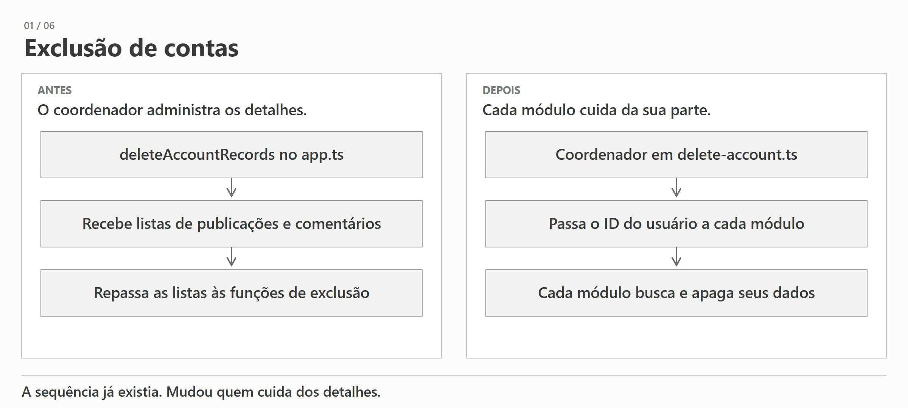
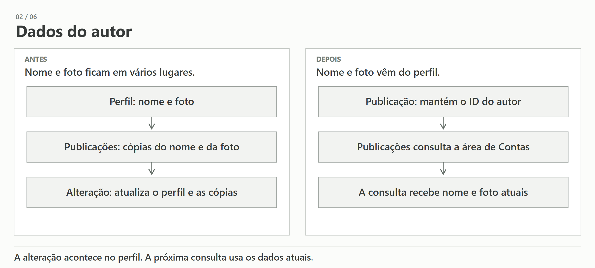
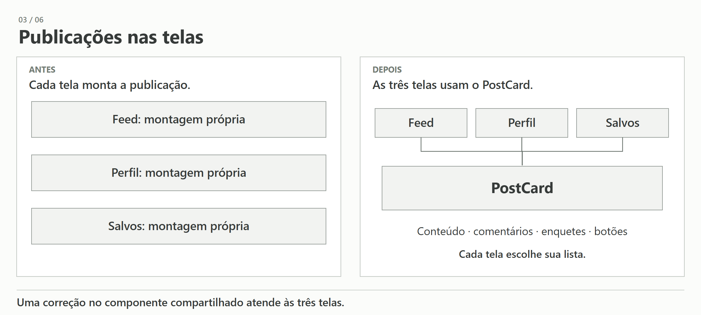
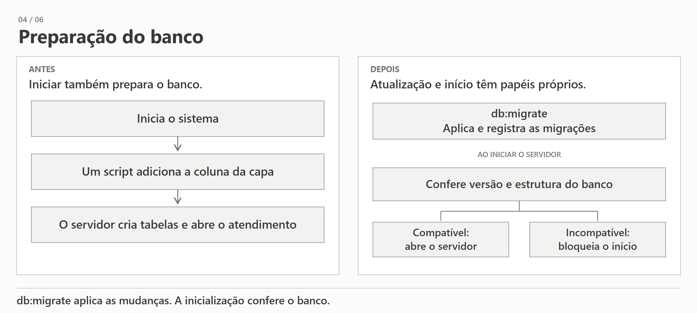
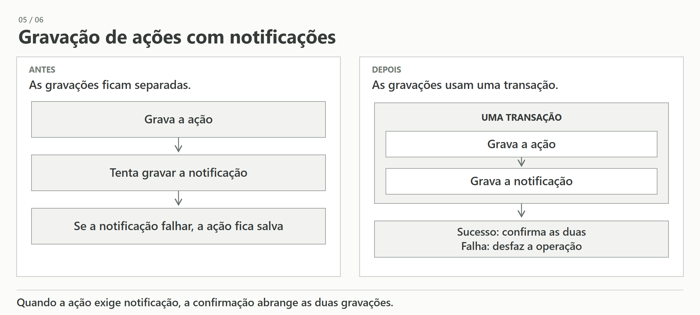
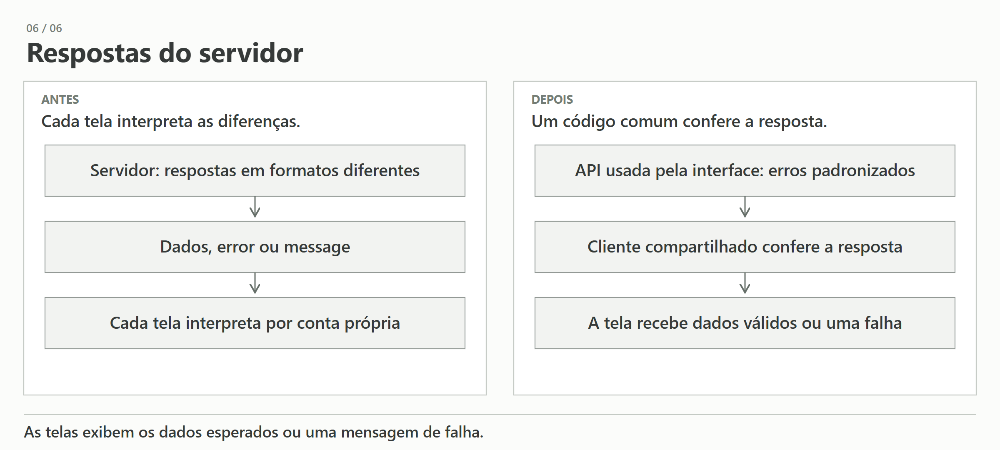

# Reengenharia arquitetural do Swiftline

## Contexto

O Swiftline é um protótipo de rede social que permite publicar conteúdos, interagir e trocar mensagens. A reengenharia arquitetural foi aplicada a seis pontos com concentração de responsabilidades, repetição de código ou procedimentos distintos para a mesma operação.

As referências dos recortes de código estão registradas no [manifesto de evidências](evidencias/reengenharia/manifesto.json).

## 1. Exclusão de contas



A coordenação da exclusão foi transferida de `deleteAccountRecords`, em `app.ts`, para `delete-account.ts`. Os módulos de Publicações, Rede, Mensagens, Notificações e Contas passaram a localizar e remover seus próprios registros. A execução sequencial e a transação foram preservadas.

<details>
<summary>Código-fonte: antes e depois</summary>

### Antes

[src/app.ts](evidencias/reengenharia/01-antes-01.txt) · linhas 341–349

```ts
async function deleteAccountRecords(user: User) {
  await sequelize.transaction(async (transaction) => {
    const { postIds, commentIds } = await findAccountContentIds(user.id, transaction);
    await deleteAccountInteractions(user.id, postIds, commentIds, transaction);
    await deleteAccountRelationships(user.id, transaction);
    await deleteAccountContent(user, postIds, transaction);
  });
}

```

### Depois

[src/workflows/delete-account.ts](../src/workflows/delete-account.ts#L26) · linhas 26–32

```ts
    await dependencies.unitOfWork.run(async (modules) => {
      await modules.posts.removeAccountData(account.id);
      await modules.network.removeAccountData(account.id);
      await modules.messages.removeAccountData(account.id);
      await modules.notifications.removeAccountData(account.id);
      await modules.accounts.removeAccount(account.id);
    });
```

</details>


## 2. Dados do autor



O nome e a foto do autor deixaram de ser copiados para as publicações. As publicações mantêm o `userId`, utilizado na consulta dos dados atuais em Contas. A atualização desses dados ocorre apenas no perfil.

<details>
<summary>Código-fonte: antes e depois</summary>

### Antes

[src/app.ts](evidencias/reengenharia/02-antes-01.txt) · linhas 235–240

```ts
      if (user.username !== previousUsername || user.avatar !== previousAvatar) {
        await Post.update(
          { author: user.username, avatar: user.avatar },
          { where: { userId: user.id }, transaction },
        );
      }
```

### Depois

[src/modules/posts/application/post-authors.ts](../src/modules/posts/application/post-authors.ts#L1) · linhas 1–18

```ts
import type { AuthorDirectory } from '../../accounts/public.js';

export async function resolvePostAuthors<T extends { userId: number }>(
  posts: T[],
  directory: AuthorDirectory,
): Promise<Array<T & { author: string; avatar: string | null }>> {
  if (!posts.length) return [];
  const authors = await directory.findByIds([...new Set(posts.map((post) => post.userId))]);
  const byId = new Map(authors.map((author) => [author.id, author]));
  return posts.map((post) => {
    const author = byId.get(post.userId);
    return {
      ...post,
      author: author?.username ?? 'Usuário indisponível',
      avatar: author?.avatar ?? null,
    };
  });
}
```

</details>


## 3. Publicações nas telas



As implementações de publicação do Feed, Perfil e Salvos foram reunidas no `PostCard`. O componente concentra o conteúdo, os comentários, as enquetes e os controles da publicação. Cada tela mantém a seleção da sua lista.

<details>
<summary>Código-fonte: antes e depois</summary>

### Antes

[client/App.tsx](evidencias/reengenharia/03-antes-01.txt) · linhas 1234–1241

```tsx
            <p className="post-content">{post.content}</p>
            {post.image && (
              
            )}
            {post.poll && (
              <PostPoll post={post} onUpdate={updatePost} onPollDeleted={removePoll} />
            )}
            <PostActions post={post} currentUserId={user.id} onUpdate={updatePost} />
```

[client/SwiftProfile.tsx](evidencias/reengenharia/03-antes-02.txt) · linha 97

```tsx
<p>{post.content}</p>{post.image && }<ProfilePostActions post={post} onUpdate={updatePost}/>
```

### Depois

[client/pages/Feed.tsx](../client/pages/Feed.tsx#L405) · linha 405

```tsx
        {posts.map((post, index) => <PostCard key={post.id} post={post} currentUserId={user.id} openProfile={openProfile} era={eras[index % eras.length]} />)}
```

[client/pages/SwiftProfile.tsx](../client/pages/SwiftProfile.tsx#L64) · linha 64

```tsx
      {posts.map((post) => <PostCard key={post.id} post={post} currentUserId={viewer.id} openProfile={openProfile} variant="profile" era="folklore" />)}
```

[client/pages/SavedPosts.tsx](../client/pages/SavedPosts.tsx#L22) · linha 22

```tsx
          {posts.map((post) => <PostCard key={post.id} post={post} currentUserId={user.id} openProfile={openProfile} variant="saved" />)}
```

</details>


## 4. Preparação do banco



A preparação do banco foi separada da inicialização do servidor. O comando `db:migrate` aplica as migrações numeradas e registra sua execução. Na inicialização, `server.ts` valida a versão e a estrutura do banco antes de abrir o servidor.

<details>
<summary>Código-fonte: antes e depois</summary>

### Antes

[src/server.ts](evidencias/reengenharia/04-antes-01.txt) · linhas 9–12

```ts
  try {
    await sequelize.authenticate();
    console.log('MySQL conectado');
    await sequelize.sync();
```

[package.json](evidencias/reengenharia/04-antes-02.txt) · linhas 7–8

```json
    "prepare:database": "tsc -p tsconfig.server.json && node scripts/apply-cover-local.mjs",
    "prestart": "npm run prepare:database",
```

### Depois

[src/server.ts](../src/server.ts#L11) · linhas 11–15

```ts
    await sequelize.authenticate();
    console.log('MySQL conectado');
    await assertDatabaseReady();
    startImageMaintenance();
    app.listen(port, () => console.log(`Swiftline está online em http://localhost:${port}`));
```

[src/infrastructure/database/db-command.ts](../src/infrastructure/database/db-command.ts#L13) · linhas 13–15

```ts
    } else if (operation === 'migrate') {
      const executed = await migrateDatabase(connection);
      console.log(executed.length ? 'Migrações aplicadas: ' + executed.join(', ') : 'O banco já está atualizado.');
```

</details>


## 5. Gravação de ações com notificações



A gravação de comentários, curtidas e ações de seguir foi integrada ao registro das respectivas notificações em `post-interactions.ts`. Quando há notificação, as duas gravações utilizam a mesma transação, com confirmação ou reversão de toda a operação.

<details>
<summary>Código-fonte: antes e depois</summary>

### Antes

[src/app.ts](evidencias/reengenharia/05-antes-01.txt) · linhas 702–711

```ts
  const comment = await Comment.create({ postId: post.id, userId: req.userId!, content });
  if (post.userId !== req.userId) {
    const actor = await User.findByPk(req.userId);
    await Notification.create({
      userId: post.userId,
      actorId: req.userId!,
      type: 'comment',
      message: `${actor?.username ?? 'Alguém'} respondeu à sua publicação.`,
    });
  }
```

### Depois

[src/workflows/post-interactions.ts](../src/workflows/post-interactions.ts#L14) · linhas 14–22

```ts
    comment: (input: { userId: number; postId: number; content: string }) => unitOfWork.run(async ({ accounts, posts, notifications }) => {
      const post = await posts.lockPost(input.postId);
      if (!post) throw new InteractionError('POST_NOT_FOUND');
      const actor = await accounts.findById(input.userId);
      if (!actor) throw new InteractionError('USER_NOT_FOUND');
      const comment = await posts.addComment(post.id, actor.id, input.content);
      if (post.userId !== actor.id) await notifications.record({ userId: post.userId, actorId: actor.id, type: 'comment', message: `${actor.username} respondeu à sua publicação.` });
      return { ...comment, user: actor };
    }),
```

[src/infrastructure/database/unit-of-work.ts](../src/infrastructure/database/unit-of-work.ts#L8) · linhas 8–12

```ts
  return {
    async run(operation) {
      return database.transaction((transaction) => operation(createScope(transaction)));
    },
  };
```

</details>


## 6. Respostas do servidor



Os erros da API utilizada pela interface foram padronizados em `api-errors.ts`. A leitura das respostas foi reunida em `client/shared/api.ts`, que valida o tipo de conteúdo, os erros e o formato dos dados antes de disponibilizá-los às telas.

<details>
<summary>Código-fonte: antes e depois</summary>

### Antes

[client/App.tsx](evidencias/reengenharia/06-antes-01.txt) · linhas 1919–1924

```ts
  const load = async () => {
    const response = await fetch(`/api/posts/${postId}/comments`, { headers: headers() });
    const comments = await response.json();
    setItems(comments);
    onCountChange(comments.length);
  };
```

[src/app.ts](evidencias/reengenharia/06-antes-02.txt) · linha 383

```ts
    return res.status(401).json({ error: 'Entre na sua conta para ver quem você segue.' });
```

[src/app.ts](evidencias/reengenharia/06-antes-03.txt) · linha 363

```ts
  if (!user) return res.status(404).json({ message: 'Usuário não encontrado.' });
```

### Depois

[src/http/api-errors.ts](../src/http/api-errors.ts#L8) · linhas 8–10

```ts
export function sendApiError(req: Request, res: Response, status: number, message: string, code = codes[status] ?? 'INTERNAL_ERROR', fields?: Fields): void {
  res.status(status).json({ error: { code, message, ...(fields ? { fields } : {}) }, requestId: req.requestId ?? randomUUID() });
}
```

[client/shared/api.ts](../client/shared/api.ts#L22) · linhas 22–29

```ts
    const response = await fetch(endpoint, { ...options, headers, signal: controller.signal });
    const contentType = response.headers.get('content-type') ?? '';
    if (!contentType.toLowerCase().includes('application/json')) throw new ApiError('INVALID_RESPONSE', 'O servidor enviou uma resposta inesperada. Tente novamente.', response.status);
    let body: unknown;
    try { body = await response.json(); } catch { throw new ApiError('INVALID_RESPONSE', 'Não foi possível ler a resposta do servidor.', response.status); }
    if (!response.ok) {
      let failure: ApiFailure;
      try { failure = decodeFailure(body); } catch { throw new ApiError('INVALID_RESPONSE', 'O servidor enviou uma falha em formato inesperado.', response.status); }
```

[client/shared/api.ts](../client/shared/api.ts#L37) · linha 37

```ts
    try { return decode(body); } catch { throw new ApiError('INVALID_RESPONSE', 'Os dados recebidos estão incompletos. Tente novamente.', response.status); }
```

</details>


## Conclusão

A reengenharia arquitetural do Swiftline reorganizou as responsabilidades e a comunicação entre as telas, os módulos, o servidor e o banco. Cada parte passou a solicitar as operações necessárias à responsável por executá-las. As seis mudanças reduziram a repetição e a concentração de detalhes nos mesmos arquivos, o que facilita a manutenção.

## Referências no projeto

| Mudança | Código principal | Registro detalhado |
| --- | --- | --- |
| Exclusão de contas | [delete-account.ts](../src/workflows/delete-account.ts) | [Caso 1](caso1-exclusao-conta-aplicada.md) |
| Dados do autor | [post-authors.ts](../src/modules/posts/application/post-authors.ts) | [Caso 2](caso2-autores-perfil-aplicado.md) |
| Publicações nas telas | [PostCard.tsx](../client/features/posts/components/PostCard.tsx) | [Caso 3](caso3-publicacoes-compartilhadas-aplicado.md) |
| Preparação do banco | [Migrações](../migrations/current/) e [server.ts](../src/server.ts) | [Caso 4](caso4-banco-versionado-aplicado.md) |
| Ações com notificações | [post-interactions.ts](../src/workflows/post-interactions.ts) | [Caso 5](caso5-operacoes-e-imagens-aplicado.md) |
| Respostas do servidor | [api-errors.ts](../src/http/api-errors.ts) e [api.ts](../client/shared/api.ts) | [Caso 6](caso6-comunicacao-aplicada.md) |

As verificações da implementação constam no [relatório técnico](relatorio-reengenharia-arquitetural.md).
