# Reengenharia arquitetural do Swiftline

Implementação realizada em 21 de novembro de 2026.

## Parte 1 - Antes

No início, boa parte do código do Swiftline estava concentrada em dois arquivos. O `App.tsx` da interface reunia as telas, enquanto o `app.ts` do servidor concentrava as rotas e as operações com o banco. Para alterar uma funcionalidade, era preciso procurar seu código no meio de outras partes do sistema.

O `client/App.tsx` tinha 2.865 linhas. Login, cadastro, feed, comentários, enquetes e mensagens estavam nesse arquivo, junto de outras telas. No servidor, `src/app.ts` tinha 927 linhas e 39 rotas. As pastas de rotas e controladores existiam, mas estavam vazias.

A dificuldade também aparecia nas regras repetidas. Feed, Perfil e Salvos exibiam publicações, mas usavam códigos diferentes para isso. O Perfil tinha seus próprios comentários e botões. Uma correção feita no Feed precisava ser conferida também nas outras telas.

Os dados do autor seguiam uma lógica parecida: nome e foto ficavam no perfil e nas publicações. Quando o usuário alterava esses dados, o sistema precisava atualizar as cópias. Havia ainda um trecho na inicialização que tentava corrigir essas informações.

## Parte 2 - Depois

O primeiro passo foi separar o código. As telas foram para `client/pages`, e as chamadas ao servidor ficaram em `client/services`. As rotas e os controladores receberam arquivos próprios, separados das operações de cada funcionalidade.

Com isso, os arquivos de entrada ficaram menores. Na versão de 21 de novembro, a divisão ficou assim:

| Arquivo | Linhas | Responsabilidade |
| --- | ---: | --- |
| `client/App.tsx` | 129 | Cuida da sessão, da navegação e da escolha da tela. |
| `src/app.ts` | 30 | Configura o Express, conecta as rotas e reúne o tratamento das respostas e dos erros. |
| `src/server.ts` | 23 | Conecta ao banco, confere sua versão e estrutura, inicia a rotina de imagens e abre o servidor. |

Depois de separar os arquivos, foi possível revisar as ligações entre essas partes. As mudanças começaram pela exclusão de conta.

### 1. Exclusão de conta

Excluir uma conta exigia mais do que remover o usuário. Era necessário apagar suas publicações, interações, mensagens, relações e notificações. Tudo isso ficava sob responsabilidade do serviço de contas, que consultava diretamente as tabelas dessas funcionalidades.

**Antes**

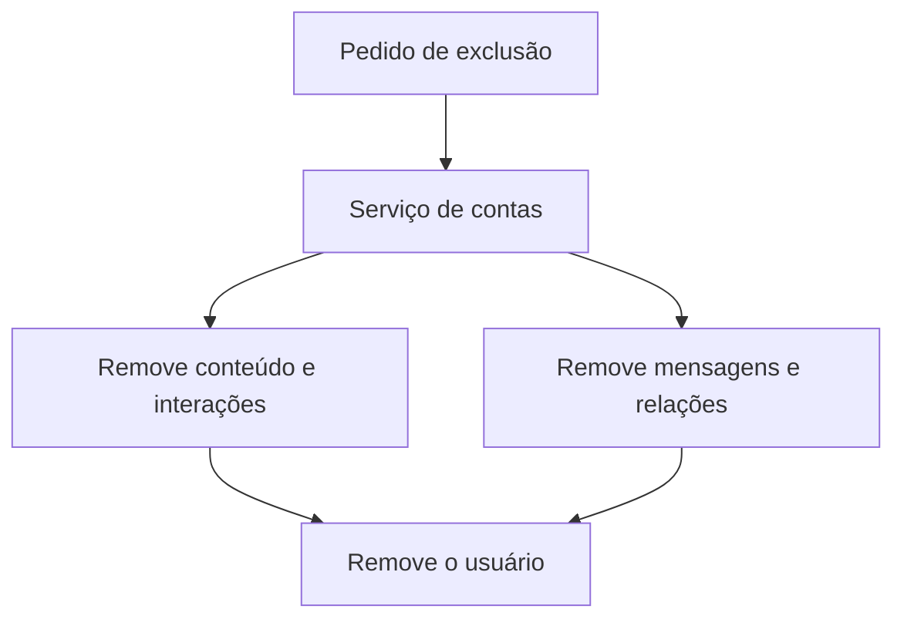

Esse serviço deixou de fazer todas as remoções por conta própria. A exclusão passou a chamar cada módulo: mensagens apaga as mensagens enviadas e recebidas; publicações apaga o conteúdo e as interações; rede e notificações removem os registros que lhes pertencem. O usuário é removido por último.

**Depois**

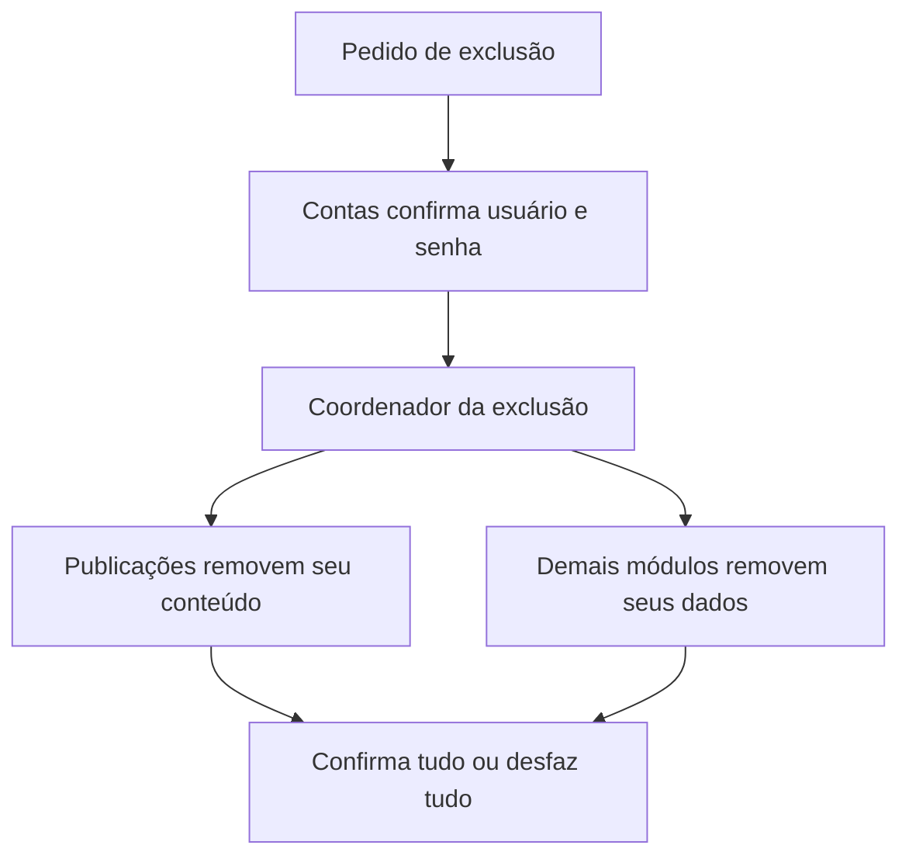

A transação que já existia foi mantida. Se alguma etapa falhar antes da confirmação, as remoções no banco são desfeitas. A diferença está em quem conhece cada dado: uma mudança no armazenamento de mensagens fica no módulo de mensagens, sem exigir que contas conheça suas tabelas.

### 2. Nome e foto do autor

Cada publicação guardava uma cópia do nome e da foto de quem publicou. Por isso, uma troca de foto no perfil também exigia alterar as publicações daquele usuário.

**Antes**

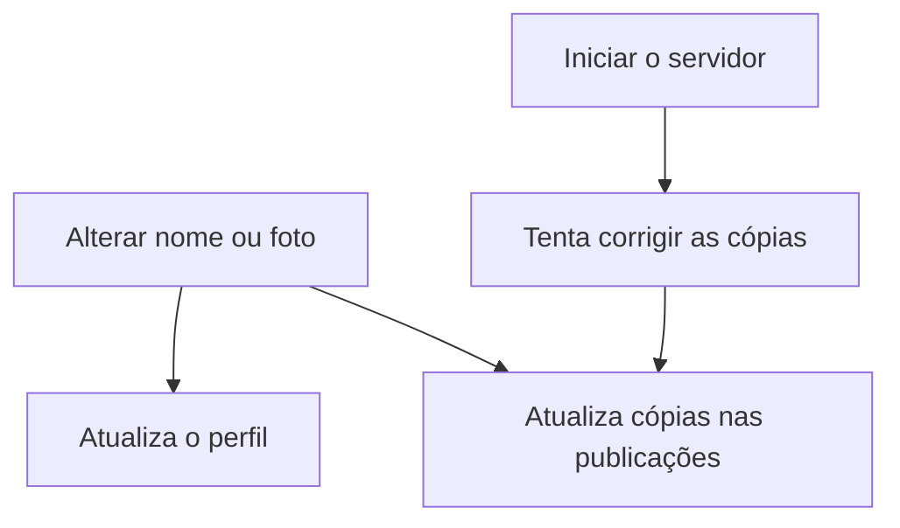

O perfil passou a ser o lugar de onde esses dados são consultados. A publicação mantém `userId` para identificar o autor, e a consulta busca o nome e a foto atuais antes de enviar a resposta à tela.

**Depois**

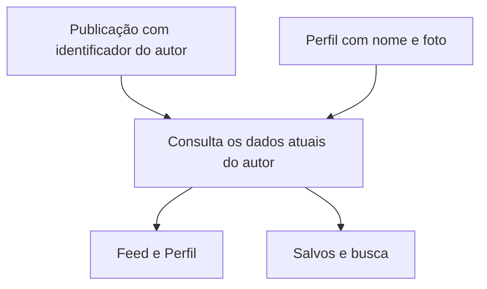

Assim, trocar a foto altera o perfil. Na próxima consulta, Feed, Perfil, Salvos e busca recebem a foto atual. O trecho que corrigia as cópias na inicialização foi retirado. As colunas antigas de nome e foto também saíram das publicações, após a cópia de seus valores para backup.

### 3. Publicações nas três telas

Feed, Perfil e Salvos tinham formas diferentes de montar uma publicação. Além de repetir código, isso deixava diferenças nas ações disponíveis. As enquetes, por exemplo, não apareciam nas três telas.

**Antes**

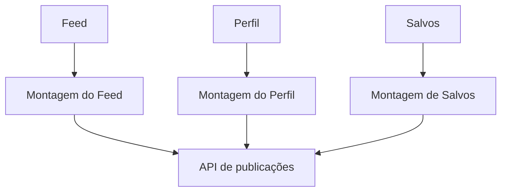

Foi criado um componente comum, o `PostCard`, usado pelas três páginas. Nele ficam o autor, o conteúdo, a imagem, os comentários, a enquete e os controles da publicação. Cada tela continua a escolher a lista que deve apresentar.

**Depois**

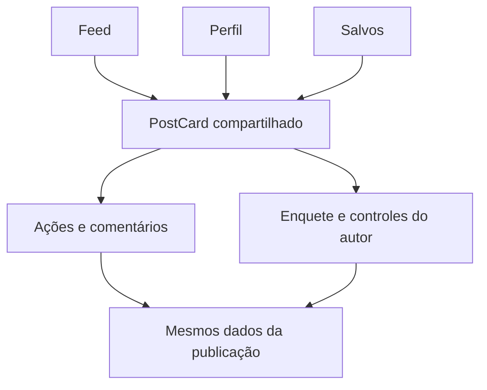

Uma correção no componente de comentários passa a valer nas três telas. Durante a sessão, os dados da publicação também são compartilhados: curtir, votar ou editar atualiza o mesmo item nas listas abertas. Remover dos salvos afeta essa lista; excluir a publicação retira o item de todas as listas carregadas.

### 4. Preparação do banco

O banco era preparado por caminhos separados. Um script criava a coluna da capa, o servidor criava tabelas ao iniciar e as migrações não formavam uma instalação completa.

**Antes**

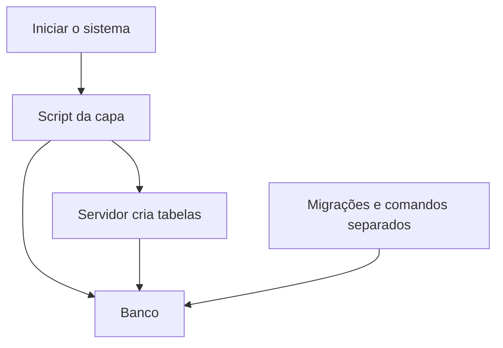

Essas alterações foram reunidas em migrações numeradas. Cada arquivo aplica uma etapa, e o banco registra quais já terminaram. A mesma sequência serve para instalar uma base vazia ou atualizar uma base existente.

**Depois**

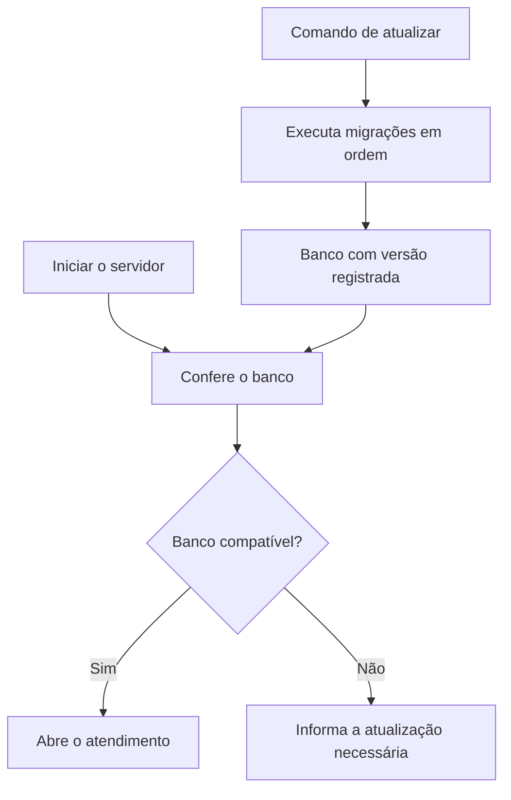

Preparar o banco e abrir o servidor ficaram separados. `db:migrate` aplica as alterações; `db:status` consulta a situação; `db:adopt` confere uma base antiga antes de registrar sua versão inicial. Ao iniciar, o servidor verifica a versão e a estrutura. Se faltar uma etapa, informa a atualização necessária e não abre o atendimento.

### 5. Comentário e notificação

O comentário mostra um problema que também ocorria em outras ações. Ele era salvo antes da notificação. Se a notificação falhasse, o pedido respondia erro, mas o comentário continuava no banco.

**Antes**

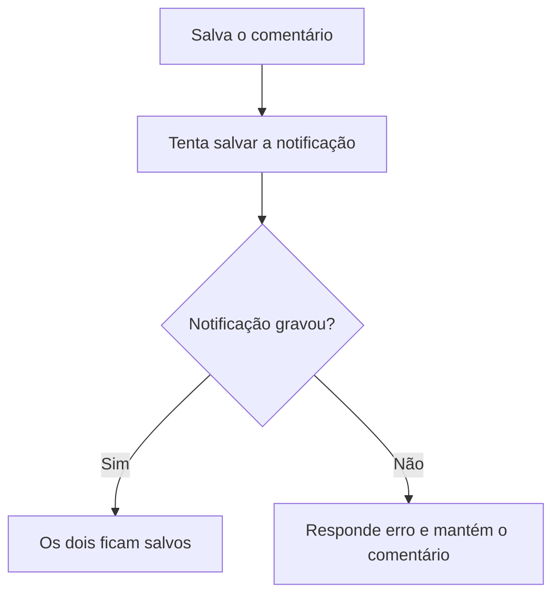

As duas gravações passaram a usar a mesma transação. O banco confirma comentário e notificação juntos ou desfaz os dois se houver uma falha antes da confirmação. A mesma mudança foi aplicada à curtida e à ação de seguir.

**Depois**

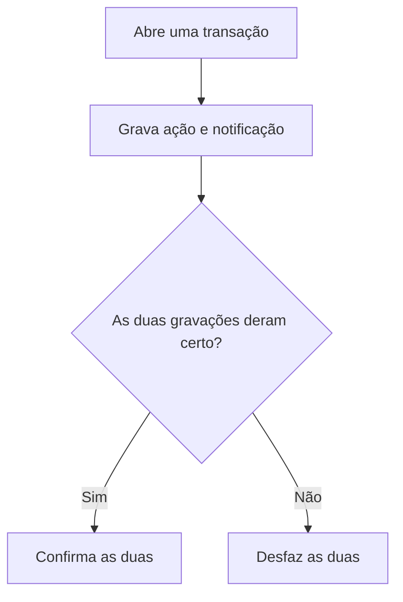

As imagens precisaram de um tratamento próprio, pois o arquivo em disco não participa da transação do banco. Um upload novo chega a uma área privada, é validado e recebe um nome definido pelo servidor.

Na troca ou exclusão, o banco registra a tarefa de remover a imagem anterior. A remoção acontece depois da confirmação dos dados. Se falhar, a tarefa fica guardada para outra tentativa. A rotina confere se a imagem ainda está em uso antes de apagá-la. A busca de arquivos sem referência se limita ao processo novo; as imagens antigas de publicações dependem de um inventário próprio.

### 6. Respostas do servidor

A tela de comentários esperava uma lista, mas podia receber um erro em outro formato. Algumas respostas usavam `error`, outras usavam `message`, e uma falha inesperada podia devolver HTML. Cada tela precisava interpretar isso sozinha.

**Antes**

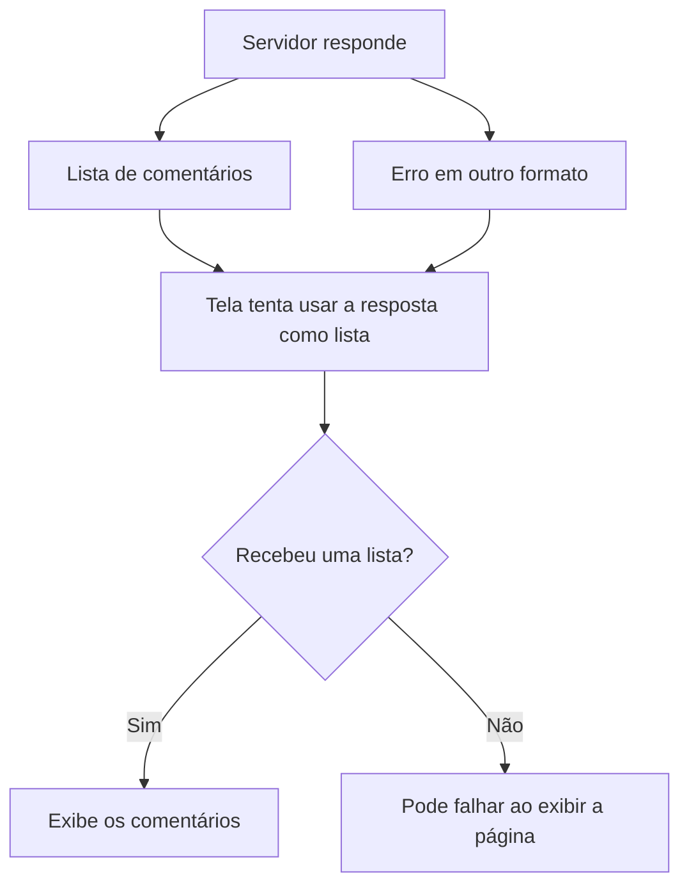

Essa leitura foi levada para o cliente HTTP comum. Ele confere a resposta e só entrega à tela os dados que correspondem ao formato esperado. Quando recebe uma falha, a tela mostra um aviso e permite tentar a leitura novamente.

**Depois**

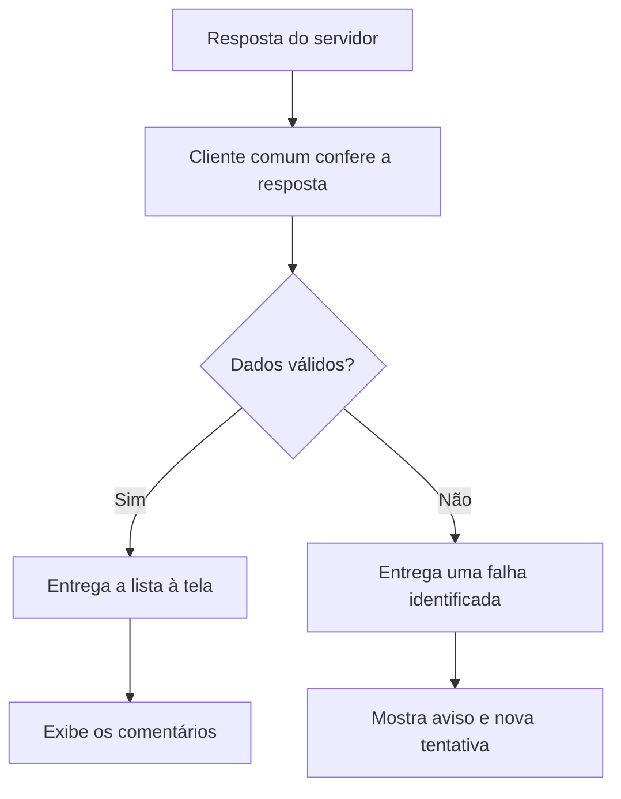

A interface usa `/api/v2`, que segue esse formato. As 39 rotas anteriores de `/api` continuam disponíveis para compatibilidade e chamam os mesmos serviços.

Também foram corrigidas diferenças entre tela e banco. O texto da publicação aceita até 280 pontos de código Unicode na criação, na edição e na pergunta da enquete. Localização e site, que já apareciam no perfil, passaram a ser salvos.

As listas são consultadas em páginas de 20 itens, com máximo de 50 por pedido. Nas ações de curtir, salvar, repostar e seguir, o pedido informa o estado escolhido. Enviar `liked: true` duas vezes mantém a curtida.

O tratamento das falhas passou a considerar a operação. Uma sessão expirada solicita novo login, enquanto uma senha incorreta na exclusão mantém a sessão aberta. Nas mensagens, uma resposta atrasada da conversa anterior não altera a conversa atual.

## Verificação das mudanças

Na verificação de 21 de novembro, a compilação da interface e do servidor passou, assim como os 56 testes e subtestes da suíte comum. As seis suítes MySQL também passaram:

| Suíte | Testes e subtestes aprovados |
| --- | ---: |
| Exclusão de conta | 5 |
| Dados do autor | 7 |
| Publicações nas três telas | 7 |
| Migrações do banco | 10 |
| Operações e imagens | 14 |
| Comunicação com o servidor | 12 |

Os testes usaram bancos descartáveis e incluíram falhas forçadas na notificação, no banco e na limpeza dos arquivos. Também conferiram as ações nas três telas, os pedidos simultâneos, a sessão expirada e a troca de conversa com uma resposta atrasada.

As migrações passaram primeiro por cópias da base. Na aplicação local, a comparação confirmou a preservação das 21 contas, das 22 publicações, dos demais registros anteriores e dos sete arquivos de imagem. O histórico ficou com seis migrações concluídas.

As verificações podem ser executadas na pasta `sistema` com os comandos abaixo. Os requisitos estão no [README](../README.md).

```powershell
npm test
npm run test:account:mysql
npm run test:authors:mysql
npm run test:posts:mysql
npm run test:database:mysql
npm run test:atomic:mysql
npm run test:contracts:mysql
```

## Continuidade do trabalho

As mudanças descritas foram aplicadas e verificadas na versão local. A divisão por módulos atende a esses fluxos. Ainda há serviços que consultam os modelos do banco diretamente, e a API antiga permanece disponível. A migração desses serviços e a retirada dos endereços antigos estão previstas no [projeto da arquitetura](projeto-reengenharia-arquitetural.md).
