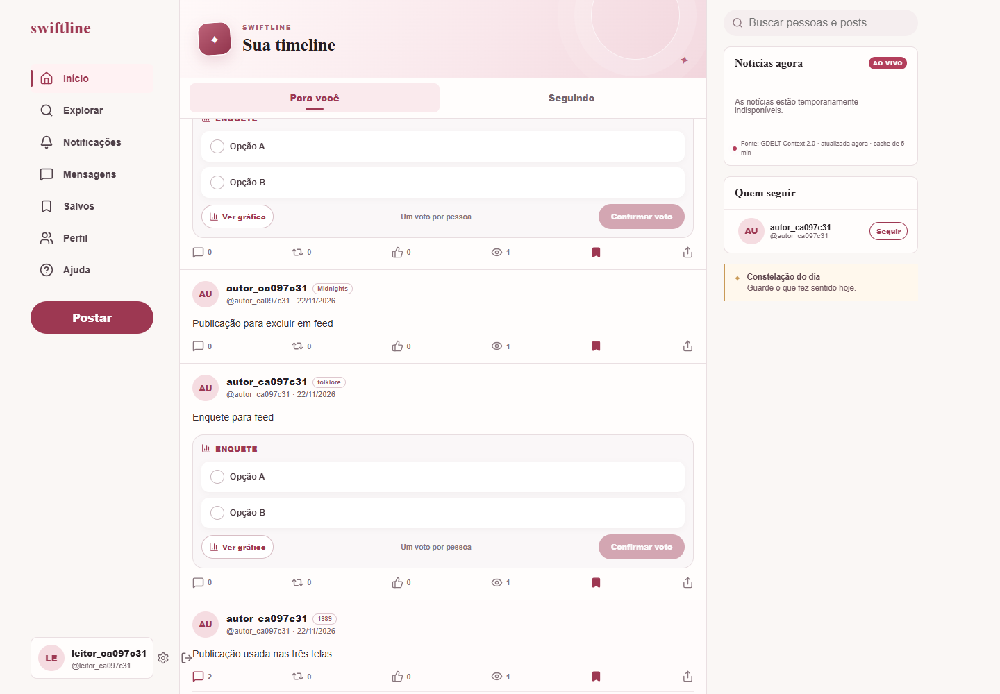
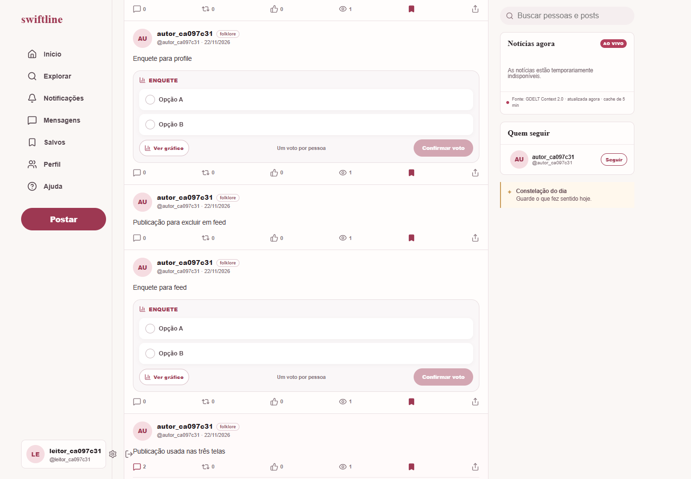
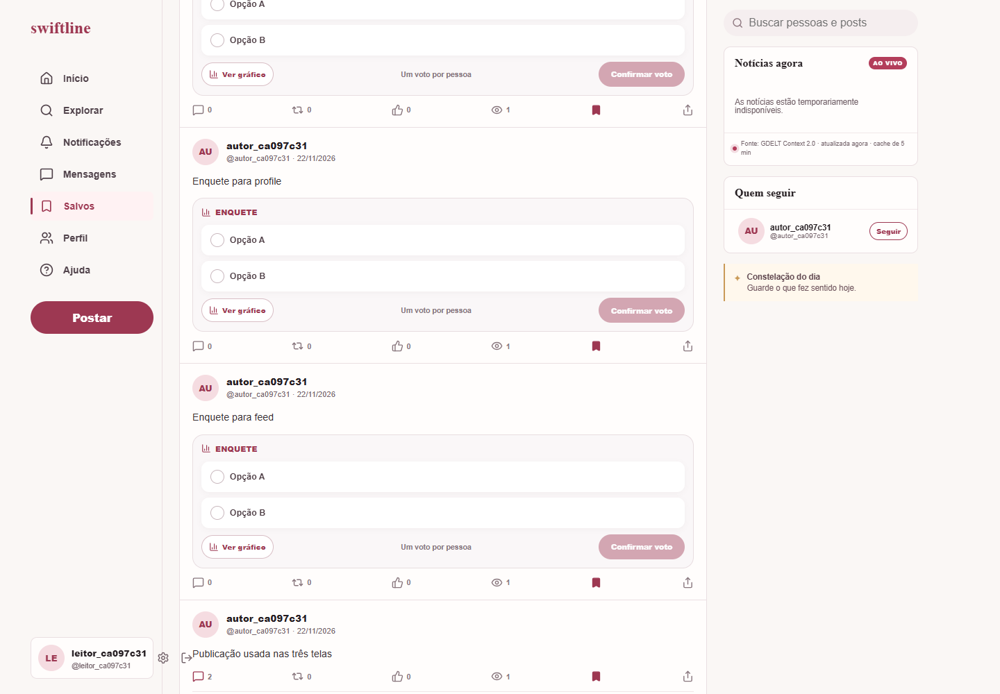

# Verificação das seis mudanças do Swiftline

**Execução:** 2026-11-22T22:25:56-04:00. Horário de Manaus.

A compilação da interface e do servidor passou. As seis suítes utilizaram instâncias MySQL descartáveis, com conferência da localização do banco e encerramento após a execução. A base utilizada pela aplicação não participou desses testes.

## Resultados

| Verificação | Aprovados | Falhas | Opcionais não executados |
| --- | ---: | ---: | ---: |
| Suíte geral | 56 | 0 | — |
| 1. Exclusão de contas | 5 | 0 | 0 |
| 2. Dados do autor | 7 | 0 | 0 |
| 3. Publicações nas três telas | 7 | 0 | 0 |
| 4. Preparação do banco | 9 | 0 | 1 |
| 5. Ações com notificações | 13 | 0 | 1 |
| 6. Respostas do servidor | 11 | 0 | 1 |

**Total:** 108 testes e subtestes aprovados, sem falhas na verificação final.

Os três cenários opcionais de cópia da base local dependem de `SWIFTLINE_DATABASE_SNAPSHOT` e não foram executados. Na suíte geral, os seis grupos MySQL são ignorados por configuração e foram executados separadamente nesta rodada.

## Verificações executadas

- **Exclusão:** remoção dos registros relacionados, preservação de outras contas, senha incorreta e reversão após falha.
- **Autor:** alteração de nome e foto sem regravar as publicações, consultas e apresentação no navegador.
- **Publicações:** Feed, Perfil e Salvos, comentários, enquetes, edição, exclusão e recuperação após falhas.
- **Banco:** instalação, migrações, adoção de bases de teste, retomada após falha e bloqueio de estruturas incompatíveis.
- **Notificações:** falha controlada em comentário, curtida e seguir, seguida de nova tentativa com gravação completa.
- **Respostas:** contratos JSON, sessão, paginação, respostas inválidas, HTML e nova tentativa no navegador.

## Repetição

Execute na pasta `sistema`:

```powershell
npm test
npm run test:account:mysql
npm run test:authors:mysql
npm run test:posts:mysql
npm run test:database:mysql
npm run test:atomic:mysql
npm run test:contracts:mysql
```

O [roteiro de demonstração](roteiro-demonstracao-reengenharia.md) descreve as ações nas telas e os arquivos correspondentes.

## Registro do ajuste de teste

A primeira execução de publicações apresentou duas falhas de verificação da interface. Uma nova execução, sem alteração da aplicação, passou. O teste foi ajustado para aguardar e conferir a resposta de edição da enquete antes de validar o texto exibido, com prazo de 15 segundos para a abertura inicial. A execução final dos sete testes e subtestes desse grupo passou.

O código da aplicação não foi alterado nesta rodada. Foram preservados os registros da primeira execução e da verificação final.

## Evidências

- [Resultado estruturado](evidencias/testes-reengenharia/resultado.json)
- [Suíte geral](evidencias/testes-reengenharia/00-suite-geral.log)
- [1. Exclusão de contas](evidencias/testes-reengenharia/01-account-deletion.log)
- [2. Dados do autor](evidencias/testes-reengenharia/02-post-authors.log)
- [3. Publicações nas três telas](evidencias/testes-reengenharia/03-post-interface.log)
- [4. Preparação do banco](evidencias/testes-reengenharia/04-database-migrations.log)
- [5. Ações com notificações](evidencias/testes-reengenharia/05-atomic-operations.log)
- [6. Respostas do servidor](evidencias/testes-reengenharia/06-api-contracts.log)
- [Primeira execução de publicações](evidencias/testes-reengenharia/03-post-interface-primeira-execucao.log)

## Capturas do navegador

As capturas abaixo foram geradas durante a verificação das três telas. As ações de edição, exclusão e falha controlada constam nos registros dos testes.

### Feed



### Perfil



### Salvos


